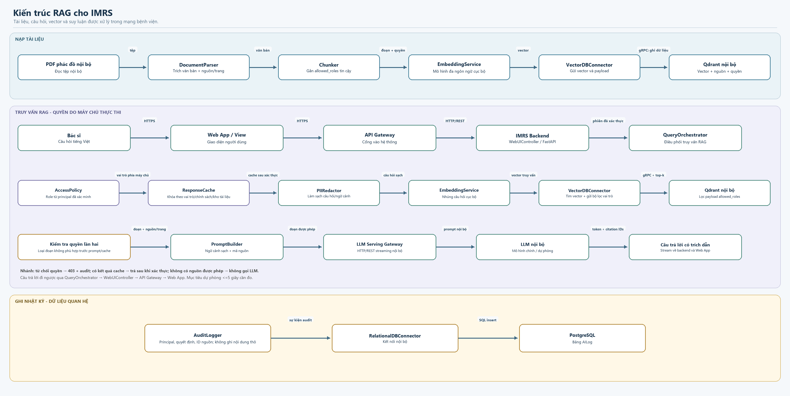
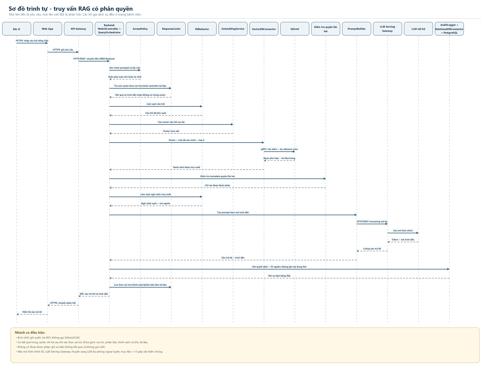

# LAB 4 - Thiết kế RAG cho IMRS

**Trạng thái:** Bản nháp do AI hỗ trợ; cần sinh viên rà soát trước khi nộp  
**Tài liệu tham chiếu (giữ ngoài repo):** `L1_PhanHungKhanh.pdf`, `LAB2_MVC.docx`, `LAB3_DYNAMIC.docx`, `LAB4_RAG_DESIGN.docx` và `SAD-Lab-Manual-v3.pdf`  
**Gói ngữ cảnh:** [`context-pack.md`](../context-pack.md)

> Bản Word Lab 4 được dùng để đối chiếu cấu trúc drivers, các quyết định D1-D3 và tiêu chí tự rà soát. Các lựa chọn trong bản Word chưa được xem là xác nhận cá nhân của sinh viên. Bản thiết kế này chọn Qdrant nội bộ để thống nhất với `VectorDBConnector` và Qdrant đã có trong Lab 2; PostgreSQL tiếp tục lưu dữ liệu quan hệ và nhật ký. Các mục tiêu thời gian trong Lab 1 là mục tiêu đề xuất, chưa có kết quả benchmark.

## 1. Các yếu tố chi phối kiến trúc

Cột `Nguồn` dùng đúng ba nhãn của bài lab. Các dòng hiện là đề xuất của AI; chưa có dòng nào được ghi nhận là sinh viên đã tự sửa hoặc bổ sung.

| Mã | Nhóm | Mô tả driver | Liên hệ với yêu cầu / ASR | Ưu tiên | Nguồn |
|---|---|---|---|---|---|
| FR-1 | Chức năng | Bác sĩ hỏi bằng tiếng Việt tự nhiên và nhận câu trả lời kèm trích dẫn tài liệu, trang hoặc đoạn nguồn. | UC04, UC09 trong Lab 1; yêu cầu RAG và trích dẫn trong Lab 4, tr. 8. | Cao | AI đề xuất – giữ nguyên |
| FR-2 | Chức năng | LLM nội bộ tạo câu trả lời dựa trên các đoạn đã truy xuất; không bịa nguồn khi không có đoạn phù hợp. | UC04, UC07 trong Lab 1; yêu cầu câu trả lời có căn cứ trong Lab 4. | Cao | AI đề xuất – giữ nguyên |
| FR-3 | Chức năng | Nạp khoảng 5.000 PDF nội bộ qua các bước đọc tài liệu, trích xuất, chia đoạn, nhúng vector và lưu metadata nguồn/quyền. | Quy mô và luồng ingestion trong Lab 4, tr. 8. | Cao | AI đề xuất – giữ nguyên |
| FR-4 | Chức năng | Gắn nhãn quyền cho phác đồ chuyên môn chỉ dành cho bác sĩ và tài liệu hướng dẫn bệnh nhân theo phạm vi truy cập tương ứng. | UC05 trong Lab 1; hai lớp tài liệu trong Lab 4, tr. 8. | Cao | AI đề xuất – giữ nguyên |
| ASR-1 | Hiệu năng | Với kịch bản 100 kết nối đồng thời, mục tiêu TTFT dưới 1,5 giây. | QA01 trong Lab 1, tr. 5-6; báo cáo ghi đây là mục tiêu đề xuất cần xác nhận và đo. | Cao; cần benchmark | AI đề xuất – giữ nguyên |
| ASR-2 | Bảo mật | Quyền bác sĩ được lấy từ danh tính đã xác thực phía máy chủ; truy vấn vector chỉ trả về đoạn thỏa bộ lọc quyền. | UC05, QA02 và BC03 trong Lab 1; cơ chế kiểm soát truy cập Lab 4. | Bắt buộc | AI đề xuất – giữ nguyên |
| ASR-3 | Bảo mật | Phát hiện, chặn và ghi nhật ký các tình huống SQL injection/prompt injection trong bộ kiểm thử; mục tiêu rò rỉ PII là 0% trong các tình huống đó. | QA02 và BC03 trong Lab 1, tr. 6-7. Đây là mục tiêu kiểm thử, không phải bảo đảm đã đạt. | Bắt buộc | AI đề xuất – giữ nguyên |
| ASR-4 | Khả dụng | Khi LLM nội bộ chính lỗi, phân hệ tiếp tục hoạt động và chuyển sang mô hình dự phòng ngoại tuyến; mục tiêu phục hồi không quá 5 giây. Lab 4 ghi nhận yêu cầu, cơ chế triển khai chi tiết thuộc Lab 5. | QA03 trong Lab 1, tr. 6; mốc 5 giây là mục tiêu đề xuất cần xác nhận bằng thử nghiệm. | Trung bình; chi tiết triển khai ở Lab 5 | AI đề xuất – giữ nguyên |
| ASR-5 | Khả năng sửa đổi | Có thể thay mô hình embedding sau `EmbeddingService`; ingestion và truy vấn dùng cùng mô hình/phiên bản; khi đổi mô hình phải nhúng lại toàn kho vì vector thuộc các không gian khác nhau. | Yêu cầu khả năng sửa đổi trong Lab 4, tr. 9; bản Word Lab 4 nêu rõ hệ quả re-embedding. | Trung bình | AI đề xuất – giữ nguyên |
| ASR-6 | Khả năng kiểm toán | Ghi quyết định cho phép/từ chối, mã người dùng phù hợp chính sách và ID nguồn đã dùng; không ghi câu hỏi hoặc nội dung bệnh án thô vào nhật ký. | UC06, QA02, BC03 trong Lab 1; `AuditLogger` trong Lab 4. | Cao | AI đề xuất – giữ nguyên |
| CON-1 | Ràng buộc dữ liệu | Tài liệu, truy vấn, vector, prompt và suy luận phải ở trong mạng bệnh viện; không gửi dữ liệu lên dịch vụ công cộng. | TC01, TC03 và BC03 trong Lab 1; Lab 4, tr. 8. | Bắt buộc | AI đề xuất – giữ nguyên |
| CON-2 | Ràng buộc hạ tầng | Môi trường mục tiêu có cụm máy chủ nội bộ và một GPU RTX 4090 với 24 GB VRAM. Embedding RAG dùng chung tài nguyên GPU với LLM; Lab 5 còn dự kiến tác vụ tóm tắt. | Bối cảnh Lab 1, tr. 2; bản Word Lab 4 nhắc đến chia sẻ GPU giữa các mô hình. Đây là cấu hình mục tiêu, không phải yêu cầu máy làm bài lab. | Bắt buộc | AI đề xuất – giữ nguyên |
| CON-3 | Ràng buộc kinh doanh | Ngân sách dự án không quá 15.000 USD. | BC01 trong Lab 1, tr. 2. | Bắt buộc | AI đề xuất – giữ nguyên |
| CON-4 | Ràng buộc tiến độ | Hoàn thành triển khai và kiểm thử lâm sàng trong bốn tháng. | BC02 trong Lab 1, tr. 2. | Bắt buộc | AI đề xuất – giữ nguyên |

## 2. So sánh phương án

Các nhận định dưới đây là so sánh định tính, không phải số đo. Chưa có báo giá nhà cung cấp hoặc benchmark trên corpus và phần cứng IMRS. Qdrant được chọn để kế thừa kiến trúc Lab 2, đồng thời vẫn cần đánh giá tải và chi phí vận hành trước khi triển khai thật.

### D1 - Kho vector

| Phương án | Tốc độ và truy xuất | Bảo mật / PII | Chi phí và vận hành | Phù hợp với kiến trúc hiện có | Kết luận |
|---|---|---|---|---|---|
| Qdrant tự triển khai trong mạng bệnh viện | Có thể lọc theo payload trong yêu cầu tìm kiếm; hiệu năng cần benchmark với corpus, quyền và tải thực tế. | Không cần gửi dữ liệu ra ngoài nếu triển khai và cấu hình nội bộ đúng. | Thêm dịch vụ cần bảo mật, lưu trữ bền vững, sao lưu, giám sát và nâng cấp. | Đã xuất hiện trong Lab 2 qua `VectorDBConnector`; có thể giữ giao diện connector. | **Chọn** để thống nhất với Lab 2 và bản Word tham khảo. |
| pgvector trên PostgreSQL hiện có | Hỗ trợ tìm gần nhất theo cosine và kết hợp điều kiện `WHERE`. Với ANN, bộ lọc có thể được áp dụng sau khi quét chỉ mục nên kết quả có thể ít hơn `k`; cần đo và cân nhắc quét lặp hoặc tìm kiếm chính xác. | Có thể giữ DB trong mạng nội bộ; cần thiết kế ACL và vận hành PostgreSQL phù hợp. | Có thể giảm số dịch vụ; nhưng phải xác nhận PostgreSQL sẵn có, năng lực lưu vector và tải chung với dữ liệu nghiệp vụ. | Không khớp lựa chọn Qdrant trong Lab 2; đổi sẽ làm khác kiến trúc nền đã vẽ. | Không chọn cho bản Lab 4 này; có thể xem xét lại nếu đánh giá vận hành chứng minh có lợi. |
| Vector DB dạng dịch vụ đám mây | Có thể giảm một phần công việc tự vận hành; hiện không có số liệu độ trễ hoặc báo giá để kết luận. | Gửi tài liệu/truy vấn ra ngoài mạng không thỏa CON-1. | Phí dịch vụ và phụ thuộc nhà cung cấp; chưa có báo giá. | Không phù hợp ràng buộc dữ liệu. | **Loại** vì CON-1. |

### D2 - Mô hình embedding

| Phương án | Tốc độ và vận hành | Bảo mật / PII | Khả năng thay đổi | Kết luận |
|---|---|---|---|---|
| Mô hình đa ngôn ngữ chạy nội bộ | Dùng chung GPU với LLM và tác vụ dự kiến ở Lab 5; phải đo VRAM, tranh chấp tài nguyên, độ trễ và chất lượng tiếng Việt/y khoa. | PDF và câu hỏi không rời mạng bệnh viện. | Một `EmbeddingService` logic dùng cùng `model_id`/phiên bản cho ingestion và truy vấn. Đổi mô hình cần nhúng lại toàn kho và kiểm tra chất lượng truy xuất. | **Chọn**; chưa khóa tên model vì tài liệu Lab không quy định. |
| API embedding trên đám mây | Có thể giảm phần vận hành mô hình cục bộ; chưa có benchmark hoặc báo giá để xác nhận lợi ích. | Phải gửi PDF hoặc câu hỏi ra ngoài mạng, trái CON-1. | Phụ thuộc nhà cung cấp và kết nối ngoài. | **Loại** vì CON-1. |

### D3 - Phân quyền khi truy xuất

| Phương án | Bảo mật | Chất lượng kết quả | Vận hành | Kết luận |
|---|---|---|---|---|
| Bộ lọc role trong cùng yêu cầu tìm kiếm Qdrant | `AccessPolicy` suy ra role từ phiên đã xác thực phía máy chủ. `VectorDBConnector` gửi bộ lọc trên payload `allowed_roles`; ứng dụng kiểm tra lại quyền của từng đoạn trước khi đưa vào cache/prompt. | Tìm trong phạm vi quyền; độ đầy đủ top-k vẫn cần benchmark theo phân bố role và dữ liệu. | Cần gắn payload quyền tin cậy khi nạp tài liệu và lập chỉ mục payload cho trường lọc. | **Chọn**. |
| Lấy top-k chung rồi mới lọc quyền ở ứng dụng | Các đoạn trái quyền đã rời vector store và vào ứng dụng trước khi bị loại; một nhánh lỗi có thể đưa chúng vào prompt/cache/log. | Khi loại kết quả trái quyền, số đoạn còn lại có thể thấp hơn `k`; muốn lấy bù phải truy vấn thêm. | Nhiều caller phải tự triển khai đúng và nhất quán. | **Loại** vì rủi ro dữ liệu y tế. |
| Tách collection theo vai trò | Có thể tạo phạm vi dữ liệu riêng nếu thiết kế đồng bộ đúng; vẫn cần xác thực role máy chủ và kiểm tra quyền. | Giới hạn tìm kiếm theo collection được chọn. | Tăng khối lượng đồng bộ khi đổi quyền, chia sẻ tài liệu hoặc thêm nhóm vai trò. | Chưa chọn mặc định; cân nhắc nếu chính sách yêu cầu cô lập tập dữ liệu. |

#### Kiểm chứng khẳng định kỹ thuật

| Khẳng định | Đánh giá | Bằng chứng và áp dụng |
|---|---|---|
| Qdrant cho phép thêm điều kiện trên payload vào truy vấn tìm kiếm và khuyến nghị lập payload index cho các trường lọc. | Đúng. | Tài liệu chính thức mô tả điều kiện lọc payload và khuyến nghị tạo payload index trước khi nạp dữ liệu để cải thiện lọc. Dùng trường `allowed_roles`; không nhận role do trình duyệt tự khai báo. [Tài liệu lọc Qdrant](https://qdrant.tech/documentation/search/filtering/) |
| Qdrant có API gRPC và API HTTP. | Đúng. | Tài liệu triển khai liệt kê cổng `6334` cho gRPC và `6333` cho HTTP. Lab 2 cũng mô tả `VectorDBConnector` kết nối Qdrant bằng gRPC/REST; thiết kế này chọn gRPC nội bộ. [Tài liệu cài đặt Qdrant](https://qdrant.tech/documentation/installation/) |
| Qdrant tự triển khai cần được cấu hình bảo mật và cần kế hoạch sao lưu/khôi phục, giám sát, nhật ký. | Đúng. | Tài liệu Qdrant lưu ý cấu hình mặc định có thể chưa đủ an toàn và nêu các phần cần tự thiết lập khi tự vận hành. [Tài liệu cài đặt Qdrant](https://qdrant.tech/documentation/installation/) |
| pgvector hỗ trợ cosine; với ANN, bộ lọc `WHERE` có thể chạy sau khi quét chỉ mục và truy vấn có thể trả ít hơn `k`. | Đúng. | README chính thức liệt kê cosine và giải thích hành vi lọc sau quét chỉ mục cùng cơ chế quét lặp. Đây là điểm cần tính đến nếu đánh giá lại pgvector. [README pgvector](https://github.com/pgvector/pgvector/blob/master/README.md#filtering) |
| Gọi top-k toàn cục rồi xóa các đoạn trái quyền luôn giữ đủ `k` kết quả. | Sai. | Khi xóa kết quả trái quyền khỏi một danh sách hữu hạn, số phần tử còn lại có thể thấp hơn `k`; phải truy vấn bù nếu cần. Việc truy vấn bù không xóa rủi ro nội dung trái quyền đã đi vào ứng dụng ở bước trước. |

#### Vì sao lọc trong truy vấn an toàn hơn lọc sau truy vấn

Thiết kế dùng danh tính đã xác thực phía máy chủ để tạo bộ lọc role ngay trong yêu cầu tìm kiếm. Nhờ vậy vector store chỉ trả về các đoạn phù hợp với bộ lọc, trước khi chúng được dùng làm ngữ cảnh. Đây là “lọc trong truy vấn”; không khẳng định thuật toán nội bộ của Qdrant loại mọi ứng viên trái quyền trước khi duyệt chỉ mục. Payload quyền phải được tạo từ nguồn quản trị tin cậy, lập chỉ mục và cập nhật khi quyền tài liệu thay đổi.

Lọc sau truy vấn rủi ro hơn vì đoạn trái quyền đã sang ứng dụng, nơi lỗi trong cache, prompt, log hoặc một nhánh code có thể làm lộ nội dung. Ngoài ra, nếu danh sách top-k có đoạn bị xóa sau kiểm tra quyền thì kết quả còn lại có thể ít hơn `k`. Do đó thiết kế lọc trong yêu cầu vector và kiểm tra quyền lần hai ở ứng dụng trước khi cache/prompt. Cache được tách theo role, phiên bản chính sách và phiên bản corpus.

## 3. Sơ đồ kiến trúc RAG

Sơ đồ kế thừa các tên và ranh giới đã có trong Lab 2: Web App/View, API Gateway, IMRS Backend/FastAPI, `WebUIController`, `QueryOrchestrator`, `VectorDBConnector`, `RelationalDBConnector`, PostgreSQL và Qdrant. Hai nút `EmbeddingService` trên flow thể hiện cùng một dịch vụ logic được gọi ở ingestion và query; cả hai phải dùng cùng model/phiên bản để vector tài liệu và câu hỏi tương thích. Luồng xử lý âm thanh bất đồng bộ qua RabbitMQ/`TranscriptionWorker` của Lab 3 không được đưa vào luồng truy vấn văn bản RAG này; nó vẫn là luồng riêng. Qdrant nhận lọc payload trong yêu cầu tìm kiếm; payload index cho `allowed_roles` được tạo trước ingestion; ứng dụng kiểm tra quyền lại trước khi dùng đoạn truy xuất. PostgreSQL lưu audit log, không lưu vector RAG trong quyết định D1 này.

```mermaid
flowchart LR
  subgraph ING["Nạp tài liệu - trong mạng bệnh viện"]
    PDF["PDF phác đồ nội bộ"] -->|"Đọc tệp nội bộ"| PARSE["DocumentParser"]
    PARSE -->|"Văn bản + nguồn/trang"| CHUNK["Chunker<br/>gắn allowed_roles tin cậy"]
    CHUNK -->|"Đoạn văn bản"| EMBI["EmbeddingService dùng chung<br/>model/version dùng cho query"]
    EMBI -->|"Vector + payload"| VCI["VectorDBConnector"]
    VCI -->|"gRPC: upsert"| QDR["Qdrant nội bộ<br/>vector + payload + chỉ mục quyền"]
  end

  subgraph QUERY["Truy vấn - máy chủ thực thi quyền"]
    DOC["Bác sĩ"] -->|"HTTPS"| WEB["Web App / View"]
    WEB -->|"HTTPS"| GW["API Gateway"]
    GW -->|"HTTP/REST"| CTRL["IMRS Backend<br/>WebUIController"]
    CTRL -->|"Yêu cầu đã xác thực"| QO["QueryOrchestrator"]
    QO -->|"principal đã xác minh"| ACL["AccessPolicy"]
    ACL -->|"role do máy chủ suy ra / từ chối"| QO
    QO -->|"tra cứu khóa theo role/policy/corpus"| CACHE["ResponseCache"]
    CACHE -->|"kết quả có trích dẫn / không có trong cache"| QO
    QO -->|"câu hỏi"| RED["PIIRedactor"]
    RED -->|"câu hỏi đã làm sạch"| EMBQ["EmbeddingService dùng chung<br/>cùng model/version"]
    EMBQ -->|"vector truy vấn"| VCQ["VectorDBConnector"]
    VCQ -->|"gRPC: vector + bộ lọc role + top-k"| QDR
    QDR -->|"đoạn phù hợp + nguồn/trang"| VCQ
    VCQ -->|"đoạn truy xuất"| QO
    QO -->|"đoạn cần kiểm tra quyền lần hai"| ACL2["Kiểm tra quyền ứng dụng"]
    ACL2 -->|"đoạn được phép"| RED2["PIIRedactor"]
    RED2 -->|"ngữ cảnh đã làm sạch + mã nguồn"| PB["PromptBuilder"]
    PB -->|"HTTP/REST streaming nội bộ"| LLMG["LLM Serving Gateway"]
    LLMG -->|"định tuyến mô hình chính/dự phòng"| LLM["LLM nội bộ"]
    LLM -->|"câu trả lời + mã trích dẫn"| LLMG
    LLMG -->|"luồng token + trích dẫn"| QO
    QO -->|"HTTPS/SSE"| CTRL
    CTRL -->|"HTTP/REST"| GW
    GW -->|"HTTPS"| WEB
    WEB -->|"hiển thị"| DOC
    QO -->|"sự kiện không có nội dung thô"| AUD["AuditLogger"]
    AUD -->|"SQL"| RDC["RelationalDBConnector"]
    RDC -->|"SQL insert"| PG["PostgreSQL<br/>bảng AILog"]
  end
```





## 4. Sơ đồ trình tự - bác sĩ hỏi phác đồ có trích dẫn



```mermaid
sequenceDiagram
  autonumber
  actor Doctor as Bác sĩ
  participant Web as Web App
  participant GW as API Gateway
  participant Ctrl as WebUIController
  participant QO as QueryOrchestrator
  participant AP as AccessPolicy
  participant Cache as ResponseCache
  participant Red as PIIRedactor
  participant Embed as EmbeddingService (cùng model/version với ingestion)
  participant VC as VectorDBConnector
  participant Qdrant as Qdrant nội bộ
  participant Check as Kiểm tra quyền ứng dụng
  participant PB as PromptBuilder
  participant LLMG as LLM Serving Gateway
  participant LLM as LLM nội bộ
  participant Audit as AuditLogger
  participant RDC as RelationalDBConnector
  database PG as PostgreSQL AILog

  Doctor->>Web: HTTPS - nhập câu hỏi tiếng Việt
  Web->>GW: HTTPS - gửi yêu cầu
  GW->>Ctrl: HTTP/REST - chuyển yêu cầu
  Ctrl->>QO: Câu hỏi + phiên đã xác thực
  QO->>AP: Xác minh principal và lấy role
  AP-->>QO: Role do máy chủ suy ra hoặc từ chối
  alt Bị từ chối
    QO->>Audit: Ghi sự kiện từ chối, không ghi câu hỏi thô
    Audit->>RDC: Ghi sự kiện
    RDC->>PG: SQL insert
    QO-->>Ctrl: 403 - không có quyền
  else Được phép
    QO->>Cache: Tra cứu theo câu hỏi + role + phiên bản policy/corpus
    Cache-->>QO: Kết quả có trích dẫn hoặc không có trong cache
    alt Có kết quả trong cache
      QO-->>Ctrl: Câu trả lời và trích dẫn đã scope theo role
    else Cache miss
      QO->>Red: Làm sạch câu hỏi
      Red-->>QO: Câu hỏi đã làm sạch
      QO->>Embed: Tạo vector cục bộ
      Embed-->>QO: Vector câu hỏi
      QO->>VC: Tìm vector + role máy chủ + top-k
      VC->>Qdrant: gRPC - tìm kiếm + filter allowed_roles
      Qdrant-->>VC: Đoạn phù hợp + mã tài liệu/trang
      VC-->>QO: Danh sách đoạn truy xuất
      QO->>Check: Kiểm tra quyền lần hai từ metadata tin cậy
      alt Không có đoạn được phép
        QO->>Audit: Ghi sự kiện không có kết quả
        Audit->>RDC: Ghi sự kiện
        RDC->>PG: SQL insert
        QO-->>Ctrl: Không tìm thấy nguồn được phép; không gọi LLM
      else Có đoạn được phép
        Check-->>QO: Các đoạn được phép
        QO->>Red: Làm sạch ngữ cảnh truy xuất
        Red-->>QO: Ngữ cảnh sạch + mã nguồn
        QO->>PB: Tạo prompt kèm mã trích dẫn
        PB->>LLMG: HTTP/REST streaming nội bộ
        LLMG->>LLM: Gọi mô hình chính
        alt Mô hình chính lỗi
          LLMG->>LLM: Chuyển sang mô hình dự phòng ngoại tuyến
          Note over LLMG,LLM: Mục tiêu chuyển đổi <= 5 giây trong Lab 1, cần kiểm chứng
        end
        LLM-->>LLMG: Token + mã trích dẫn
        LLMG-->>PB: Luồng câu trả lời
        PB-->>QO: Câu trả lời + trích dẫn
        QO->>Audit: Ghi principal, quyết định, ID nguồn; không ghi nội dung thô
        Audit->>RDC: Ghi sự kiện
        RDC->>PG: SQL insert
        QO->>Cache: Lưu theo role/policy/corpus version
        QO-->>Ctrl: SSE - câu trả lời và trích dẫn
      end
    end
  end
  Ctrl-->>GW: HTTP/REST - phản hồi
  GW-->>Web: HTTPS - chuyển phản hồi
  Web-->>Doctor: Hiển thị câu trả lời và nguồn
```

**Quy ước:** HTTPS là ranh giới trình duyệt; HTTP/REST giữa Gateway và backend; gRPC giữa connector và Qdrant; SQL giữa connector quan hệ và PostgreSQL; SSE truyền câu trả lời dạng luồng. Ingestion và suy luận embedding chạy nội bộ. Sơ đồ không có dịch vụ cloud.

## 5. Nhật ký lỗi sơ đồ và chỉnh sửa

| Vấn đề phát hiện khi đối chiếu | Nguyên nhân / tác động | Chỉnh sửa |
|---|---|---|
| Sơ đồ tham khảo Lab 4 cho bác sĩ gọi thẳng `QueryOrchestrator`. | Bỏ qua Web App và API Gateway của Lab 2, làm sai ranh giới hệ thống đã xây dựng. | Thêm Web App, API Gateway, IMRS Backend và `WebUIController` trước `QueryOrchestrator`. |
| Bản thiết kế trước chọn pgvector. | Không nhất quán với Lab 2 và file Word Lab 4 tham khảo vốn chọn Qdrant. | Chuyển quyết định D1 sang Qdrant nội bộ; PostgreSQL dùng cho dữ liệu quan hệ và audit. |
| Dùng từ “pre-filter” có thể bị hiểu là Qdrant chắc chắn loại ứng viên trái quyền trước mọi bước duyệt chỉ mục. | Tài liệu kiểm chứng xác nhận lọc payload trong truy vấn, nhưng sơ đồ không nên khẳng định thứ tự thuật toán nội bộ chưa xác minh. | Gọi là “lọc role trong yêu cầu tìm kiếm”; thêm kiểm tra quyền lần hai ở ứng dụng và không tuyên bố về từng ứng viên nội bộ. |
| Sơ đồ cũ chưa thể hiện rõ quyền cache. | Cache không scope theo role/policy/corpus có thể làm lộ kết quả giữa nhóm người dùng. | Thêm role, policy version và corpus version vào khóa cache; kiểm tra quyền trước cả cache hit. |
| Luồng RAG văn bản có thể bị nhầm với xử lý âm thanh Lab 3. | Lab 3 mô tả RabbitMQ và `TranscriptionWorker` bất đồng bộ; đó không phải chuỗi truy vấn văn bản RAG. | Ghi rõ hai luồng riêng; không thêm RabbitMQ/worker vào sơ đồ RAG này. |
| Luồng lỗi mô hình nội bộ chưa có nhánh dự phòng. | Lab 1 có yêu cầu chuyển sang LLM dự phòng ngoại tuyến. | Bổ sung `LLM Serving Gateway` định tuyến mô hình chính/dự phòng; mốc <=5 giây vẫn là mục tiêu cần đo. |
| Hai nút `EmbeddingService` có thể bị hiểu là hai dịch vụ khác nhau. | Ingestion và query cần dùng cùng mô hình/phiên bản để vector nằm trong cùng không gian. | Ghi rõ hai nút là cùng một dịch vụ logic; đổi mô hình cần re-embedding toàn kho. |
| Ràng buộc một GPU chưa thể hiện tranh chấp tài nguyên. | LLM và embedding cùng dùng RTX 4090; Lab 5 còn có tác vụ tóm tắt dự kiến. | Bổ sung chia sẻ tài nguyên vào CON-2 và tiêu chí benchmark của D2; không đặt thêm ngưỡng VRAM/độ trễ. |

## 6. Quyết định và điều kiện cần rà soát

- D1 và D3 được ghi trong hai ADR: [`0001-chon-vector-store.md`](../adr/0001-chon-vector-store.md), [`0002-co-che-phan-quyen-truy-xuat.md`](../adr/0002-co-che-phan-quyen-truy-xuat.md).
- Chưa khóa tên mô hình embedding, kích thước chunk, số đoạn top-k, TTL cache, cấu hình Qdrant hoặc ngưỡng tải; các mục này cần benchmark/thử nghiệm và xác nhận theo rubric.
- Kiểm tra payload index của `allowed_roles`, quyền cập nhật metadata, phân quyền kết nối Qdrant, mã hóa/kết nối nội bộ, sao lưu và khôi phục trước khi triển khai.
- Xác nhận với giảng viên/sinh viên rằng mục tiêu TTFT <1,5 giây và phục hồi <=5 giây trong Lab 1 là ngưỡng chấp nhận của bài; tài liệu Lab 1 hiện ghi đây là mục tiêu đề xuất.
- Sinh viên cần thay các nhãn “AI đề xuất – giữ nguyên” nếu tự rà soát và thực sự chỉnh sửa hoặc bổ sung driver; cập nhật `AI_LOG.md` theo phần việc cá nhân.
