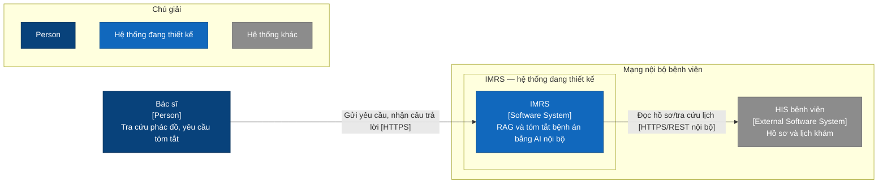
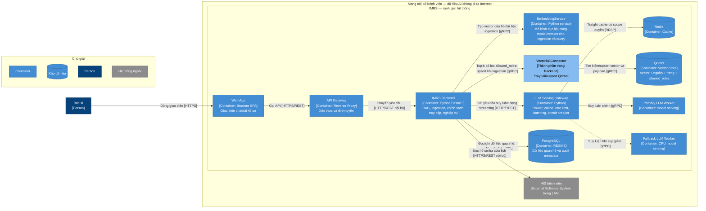
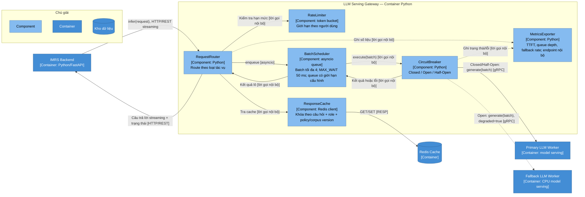
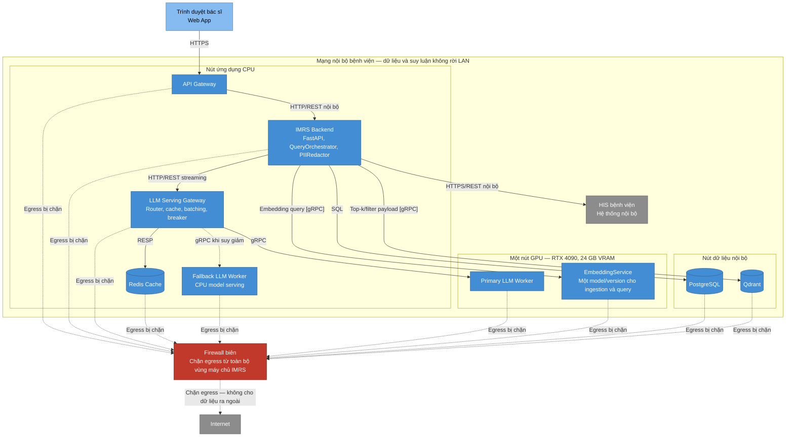

# Lab 5 — C4 và phục vụ mô hình IMRS

> **Trạng thái:** Bản Lab 5 được tổng hợp từ tài liệu tham khảo Word/Excel và baseline Lab 4 trong kho. Các số tải và thời gian xử lý dưới đây là giả định của đề bài, không phải kết quả benchmark. Nhóm tactic được trình bày theo bản tham khảo; cần ghi đúng ấn bản/trang giáo trình Bass, Clements & Kazman mà lớp sử dụng trước khi nộp.
>
> **Thông tin sinh viên:** Tự điền tên, MSSV và lớp nếu biểu mẫu của giảng viên yêu cầu. Không sao chép nhãn `[SV XÁC NHẬN]` từ tệp tham khảo như thể đã xác nhận.

## 1. Phạm vi và yêu cầu kiến trúc

Lab 5 hoàn thiện kiến trúc phục vụ LLM cho IMRS. Bác sĩ gửi yêu cầu qua Web App và API Gateway đến Backend. Backend truy xuất tài liệu được phép từ Qdrant, dùng LLM nội bộ để trả lời có nguồn; LLM Serving Gateway gom lô, giới hạn tải và chuyển sang worker dự phòng khi mô hình chính lỗi.

| Mục | Yêu cầu hoặc ràng buộc | Cách thể hiện trong thiết kế | Nguồn/căn cứ |
|---|---|---|---|
| ASR-PERF | Phục vụ 100 kết nối đồng thời trong ngưỡng TTFT đã cam kết. Lab 1 nêu TTFT dưới 1,5 giây là mục tiêu đề xuất cần đo, không phải kết quả đạt được. | LLM Serving Gateway hỗ trợ cache, giới hạn tần suất và batching; đánh giá phải đo TTFT, không dùng thời gian hoàn tất batch thay thế TTFT. | Bối cảnh Lab 1 trong `context-pack.md`; LAB5_C4_SERVING.docx, Phần A §1 và Phần B. |
| ASR-SEC | Phát hiện/chặn và ghi nhật ký SQL injection, prompt injection; mục tiêu rò rỉ PII bằng 0 trong bộ kiểm thử. Dữ liệu, vector và suy luận ở mạng nội bộ. | Xác thực/role ở phía máy chủ; bộ lọc quyền trong truy vấn Qdrant; kiểm tra quyền lần hai trước khi dùng ngữ cảnh/cache; log không chứa câu hỏi hoặc bệnh án thô. | `context-pack.md`; ADR-0002; LAB5_C4_SERVING.docx, Phần A §1 và §3. |
| ASR-AVAIL | Khi LLM chính mất kết nối, ứng dụng không sập và có thể chuyển sang mô hình dự phòng ngoại tuyến. Mục tiêu phục hồi ≤5 giây trong baseline Lab 1 là đề xuất cần kiểm chứng. | Circuit breaker điều khiển Primary/Fallback; trả cờ `degraded=true` và thông báo chế độ suy giảm. Ngưỡng lỗi, timeout và thời gian phục hồi vẫn là tham số cần đo. | `context-pack.md`; LAB5_C4_SERVING.docx, Phần A §3 và ADR-0003. |
| CON-1 | Một RTX 4090, 24 GB VRAM; LLM và embedding dùng chung GPU. Lab 5 dự kiến bổ sung tóm tắt bệnh án trên cùng hạ tầng. | Deployment đặt Primary LLM Worker và EmbeddingService trên cùng nút GPU; tải tóm tắt phải được đưa vào thử tải. | `context-pack.md`; bối cảnh đã chốt; LAB5_C4_SERVING.docx, Phần B §3. |
| CON-2 | Ngân sách tối đa 15.000 USD và thời hạn bốn tháng. | Không suy ra chi phí hoặc số lượng GPU từ phép tính thông lượng; cần báo giá/ước lượng vận hành riêng nếu dùng ngân sách để quyết định. | `context-pack.md`; LAB5_C4_SERVING.docx, Phần B §4. |
| CON-3 | Dùng Qdrant tự triển khai; phân quyền `allowed_roles` áp dụng ngay trong truy vấn. | Backend đi qua `VectorDBConnector`; kiểm tra quyền lần hai; payload index được tạo trước ingestion. | ADR-0001, ADR-0002; LAB4_RAG_DESIGN.md. |

## 2. Ánh xạ tactic và kỹ thuật hiện thực

Các thuật ngữ trong cột tactic giữ theo bảng tham khảo. Tệp tham khảo không trích trang/ấn bản taxonomy gốc; vì vậy cần đối chiếu cách gọi và nhóm trong giáo trình trước khi nộp. Các pattern, kỹ thuật và công nghệ được đặt ở cột hiện thực, không xem là tactic độc lập.

| Tactic tham khảo | Nhóm | ASR phục vụ | Hiện thực trong thiết kế | Tác động phụ/điều cần kiểm soát |
|---|---|---|---|---|
| Schedule Resources | Performance — Manage Resources | Hiệu năng/tải | `BatchScheduler` gom request, tối đa 4 request/lô, chờ tối đa 50 ms. | Chờ gom lô làm tăng latency; kích thước lô đầy không đảm bảo ở tải thấp. |
| Introduce Concurrency | Performance — Manage Resources | Năng lực xử lý đồng thời | Xử lý request bất đồng bộ giữa `RequestRouter`, queue và worker. `asyncio` là kỹ thuật hiện thực. | Tăng độ phức tạp về thứ tự, timeout, hủy request và back-pressure. |
| Bound Queue Sizes | Performance — Manage Resources | Giới hạn độ trễ khi quá tải | Queue có giới hạn cấu hình; khi đầy, từ chối/back-pressure và báo lỗi rõ cho Backend. Giá trị giới hạn chưa được chọn. | Nếu không định nghĩa hành vi khi đầy, request có thể chờ lâu hoặc bị mất không rõ nguyên nhân. |
| Maintain Multiple Copies of Data | Performance — Manage Resources | Giảm thời gian cho truy vấn lặp | `ResponseCache` trên Redis; khóa gồm dấu vân tay câu hỏi, role, phiên bản chính sách và corpus. | Cần vô hiệu hóa khi quyền/phác đồ/corpus thay đổi; kiểm tra quyền trước khi trả cache hit. |
| Limit Event Response | Performance — Control Resource Demand | Bảo vệ GPU khi tải tăng | `RateLimiter` dùng token bucket theo người dùng. | Giới hạn quá thấp có thể từ chối truy vấn hợp lệ; chính sách phải cấu hình và đo. |
| Heartbeat | Availability — Detect Faults | Phát hiện worker chính mất khả năng phục vụ | Health check riêng quan sát trạng thái Primary; kết quả được cung cấp cho breaker/giám sát. | Chu kỳ và timeout chưa chốt; mạng chập chờn có thể tạo cảnh báo giả. `MetricsExporter` không tự thay thế health check. |
| Exception Detection | Availability — Detect Faults | Phát hiện timeout/lỗi suy luận | `CircuitBreaker` nhận timeout/lỗi gọi Primary. | Timeout quá ngắn làm chuyển dự phòng giả; cần định nghĩa lỗi nào được tính. |
| Retry | Availability — Recover from Faults | Khôi phục lỗi tạm thời | Retry có giới hạn và backoff khi breaker còn Closed; không retry vô hạn hoặc tiếp tục gọi Primary khi Open. | Retry làm tăng tải/latency; giới hạn và tổng deadline phải thống nhất. |
| Degradation | Availability — Recover from Faults | Tiếp tục phục vụ khi Primary lỗi | Chuyển sang Fallback Worker và trả `degraded=true`; UI hiển thị trạng thái. | Chất lượng/năng lực Fallback chưa được đo; không trình bày câu trả lời suy giảm như kết quả bình thường. |
| Spare / passive redundancy | Availability — Recover from Faults | Sẵn sàng thay thế Primary | Fallback Worker chạy trên CPU, chỉ nhận yêu cầu khi breaker Open. | Cần xác định đây là spare nóng/ấm theo giáo trình và đo năng lực CPU; không gọi là dự phòng tương đương Primary. |

**Phân biệt thuật ngữ:** `CircuitBreaker` là pattern/cơ chế điều khiển lỗi, không phải tên tactic. Retry là chính sách riêng, không phải chức năng mặc định của circuit breaker. `Dynamic Batching`, `asyncio`, Redis, token bucket và streaming là kỹ thuật/công nghệ hiện thực. `Spare` và cách chia nhóm tactic phải được xác nhận theo ấn bản giáo trình lớp đang dùng.

## 3. C4 Level 1 — System Context



**Chú giải:** Bác sĩ là người dùng; IMRS là hệ thống đang thiết kế; HIS là hệ thống khác trong mạng bệnh viện. Không vẽ Bệnh nhân như người dùng trực tiếp vì tài liệu tham khảo chỉ mô tả bác sĩ chuyển hướng dẫn cho bệnh nhân.

## 4. C4 Level 2 — Container View



**Chú giải:** Hộp xanh đậm là container; hình trụ là kho dữ liệu; nét liền là luồng chính; nét đứt là luồng suy giảm. HIS nằm ngoài ranh giới IMRS nhưng vẫn trong mạng bệnh viện. `EmbeddingService` dùng chung một model/version cho ingestion và query; deployment đặt nó cùng nút GPU với Primary LLM.

## 5. C4 Level 3 — Component View của LLM Serving Gateway



**Chú giải:** Component nằm trong ranh giới `LLM Serving Gateway`; Primary, Fallback và Redis là container/phụ thuộc bên ngoài gateway. Tên endpoint scrape metrics chưa được chọn trong tài liệu đầu vào; `MetricsExporter` chỉ biểu diễn khả năng xuất số liệu nội bộ, không hàm ý đã triển khai Prometheus hay một nền tảng giám sát cụ thể.

## 6. Sequence Diagram — Primary lỗi và circuit breaker

```mermaid
sequenceDiagram
  autonumber
  actor Doc as Bác sĩ
  participant BE as IMRS Backend
  participant RT as RequestRouter
  participant BS as BatchScheduler
  participant CB as CircuitBreaker
  participant PW as Primary LLM Worker
  participant FW as Fallback LLM Worker
  participant MX as MetricsExporter

  Note over CB: CLOSED — gửi request tới Primary
  Doc->>BE: Đặt câu hỏi
  BE->>RT: infer(request) [HTTP/REST streaming]
  RT->>BS: enqueue(request)
  BS->>CB: execute(batch)
  CB->>PW: generate(batch) [gRPC]
  PW--xCB: Timeout/lỗi
  CB->>MX: Ghi lỗi, tăng bộ đếm
  loop Retry có giới hạn và backoff khi còn CLOSED
    CB->>PW: generate(batch) [gRPC]
    PW--xCB: Timeout/lỗi
    CB->>MX: Ghi lỗi, tăng bộ đếm
  end
  Note over CB: Đạt FAILURE_THRESHOLD → OPEN
  CB->>MX: Ghi state=OPEN
  CB->>FW: generate(batch) [gRPC]
  FW-->>CB: Kết quả dự phòng
  CB-->>BS: Kết quả + degraded=true
  BS-->>RT: Kết quả lô + degraded=true
  RT-->>BE: Streaming + trạng thái suy giảm
  BE-->>Doc: Câu trả lời + thông báo chế độ suy giảm

  Note over CB: Khi OPEN, request mới không gọi Primary
  Doc->>BE: Câu hỏi tiếp theo
  BE->>RT: infer(request)
  RT->>BS: enqueue(request)
  BS->>CB: execute(batch)
  CB->>FW: generate(batch) [gRPC]
  FW-->>CB: Kết quả dự phòng
  CB-->>BS: Kết quả + degraded=true
  BS-->>RT: Kết quả + degraded=true
  RT-->>BE: Streaming + trạng thái suy giảm
  BE-->>Doc: Câu trả lời + thông báo chế độ suy giảm

  Note over CB: Hết RESET_TIMEOUT → HALF-OPEN; chỉ cho một probe
  Doc->>BE: Câu hỏi sau thời gian chờ
  BE->>RT: infer(request)
  RT->>BS: enqueue(request)
  BS->>CB: execute(probe batch)
  CB->>PW: Probe [gRPC]
  alt Primary đã hồi phục
    PW-->>CB: Kết quả
    CB->>MX: Ghi state=CLOSED
    CB-->>BS: Kết quả bình thường
  else Primary vẫn lỗi
    PW--xCB: Timeout/lỗi
    CB->>MX: Ghi state=OPEN
    CB->>FW: generate(batch) [gRPC]
    FW-->>CB: Kết quả dự phòng
    CB-->>BS: Kết quả + degraded=true
  end
  BS-->>RT: Kết quả lô + trạng thái
  RT-->>BE: Streaming + trạng thái
  BE-->>Doc: Hiển thị câu trả lời/trạng thái
```

**Quy tắc vận hành:** Retry chỉ áp dụng khi breaker còn Closed và phải nằm trong deadline request; khi Open, request đi thẳng Fallback. Half-Open chỉ cho phép một probe đồng thời. `FAILURE_THRESHOLD`, timeout gọi mô hình, backoff và `RESET_TIMEOUT` là tham số cấu hình chưa có số đo trong tài liệu; không tự gán giá trị. Câu trả lời từ Fallback luôn được đánh dấu degraded và chuyển trạng thái về giao diện.

## 7. Deployment View



**Chú giải:** Khung lớn là mạng bệnh viện; khung con là các nút triển khai; nét liền là giao tiếp nội bộ; nét đứt có dấu chặn là egress bị firewall chặn. HIS là hệ thống khác nhưng ở trong mạng bệnh viện. Một RTX 4090 dùng chung cho Primary LLM và EmbeddingService; không triển khai embedding trên một GPU thứ hai. Tải tóm tắt bệnh án dự kiến phải được tính trong phép thử tải chung. RabbitMQ/`TranscriptionWorker` của Lab 3 không vẽ ở view serving này vì đó là luồng xử lý âm thanh bất đồng bộ riêng.

## 8. Ước lượng năng lực và độ nhạy

### 8.1 Giả định đầu vào

| Tham số | Giá trị | Diễn giải |
|---|---:|---|
| Số bác sĩ giả định | 100 | Không đồng nghĩa với 100 request đang suy luận đồng thời. |
| Chu kỳ câu hỏi | 1 request/bác sĩ/30 giây | Dùng để tính tốc độ đến trung bình. |
| Tốc độ đến `λ` | `100/30 = 3,333… req/s` | Giả định trung bình; chưa mô tả burst/tương quan thời điểm. |
| `t(1)`, `t(4)`, `t(8)` | `0,4`, `0,6`, `0,9 s` | Thời gian GPU hoàn tất cả lô theo đề, chưa đo thực tế. |
| `MAX_WAIT_TIME` | `50 ms = 0,05 s` | Thời gian gom lô tối đa, không phải tổng latency/TTFT. |

### 8.2 Thông lượng lô đầy

Công thức theo giả định đề bài: `μ = B / t(B)`, `ρ = λ / μ`. `μ` ở đây là năng lực thông lượng khi batch đầy; không tự mô tả thông lượng đạt được ở mọi mức tải.

| Kích thước lô B | t(B), giây | μ = B/t(B), req/s | λ, req/s | ρ = λ/μ | W+t(B), giây* | Kết luận theo mô hình lô đầy |
|---:|---:|---:|---:|---:|---:|---|
| 1 | 0,4 | 2,500 | 3,333 | 1,333 | 0,450 | Không đủ năng lực nếu tải kéo dài; với queue không giới hạn, backlog tăng khoảng 0,833 req/s. Với queue giới hạn, queue đầy rồi phải từ chối/back-pressure. |
| 4 | 0,6 | 6,667 | 3,333 | 0,500 | 0,650 | Đủ theo giả định batch luôn đầy; chưa chứng minh TTFT đạt SLO. |
| 8 | 0,9 | 8,889 | 3,333 | 0,375 | 0,950 | Thông lượng lý thuyết cao hơn; thời gian xử lý cả lô giả định cũng cao hơn. |

\* `W+t(B)` là phép cộng timer tối đa với thời gian xử lý batch theo workbook; **không phải độ trễ tối thiểu** và không phải TTFT. Thời gian xử lý giả định riêng là `t(B)`; thời gian chờ thực nằm trong chính sách gom lô. TTFT phải đo đến token đầu tiên, còn `t(B)` là thời gian hoàn tất cả batch.

### 8.3 Batch formation và giới hạn mô hình

- Trong 50 ms, số request kỳ vọng đến theo phép tính `λW` là khoảng `0,167`; điều này cho thấy timer ngắn không tự tạo batch 4/8 khi GPU rảnh.
- Công thức `(B−1)/λ` cho thời gian gom đủ 4/8 yêu cầu cho kết quả xấp xỉ `0,9 s`/`2,1 s` nếu giả định arrivals Poisson/stationary với tốc độ trung bình `λ`. Đây là ước lượng chờ gom từ request đầu, không phải bảo đảm cho mọi lịch đến; đề bài không nêu phân bố arrival này.
- Worksheet độ nhạy dùng `min(Bmax, 1+λW)`, nội suy `t(B)` tại batch kỳ vọng rồi tính `B/t(B)`. Đây là xấp xỉ tất định; `min` của kỳ vọng không bằng kỳ vọng của batch bị chặn nếu số request đến là ngẫu nhiên. Vì vậy thông lượng đó không được diễn giải là thông lượng bền vững hay capacity đo được.
- Mô hình nội suy tuyến tính từ B=1 đến B=4 cho `t(B)=a+sB`, với `a≈0,333 s`, `s≈0,0667 s/request`. Giải `B=λt(B)` cho `B*≈1,429`, `t(B*)≈0,429 s`; tại nghiệm `λt(B*)/B*=1`. Đây là điểm cân bằng lưu lượng ở mức sử dụng 100%, không chứng minh hàng đợi ngẫu nhiên ổn định hoặc có dư địa.
- Con số `1,5×t(B*)≈0,643 s` trong bản tham khảo là heuristic “chờ nửa lô + xử lý”, không suy ra từ mô hình arrival được mô tả. Không dùng nó làm latency hoặc TTFT dự báo.
- Chọn batch tối đa 4 và MAX_WAIT 50 ms làm cấu hình khởi điểm để thử nghiệm, không kết luận đã tối ưu. Cần đo workload đồng thời của tra cứu, tóm tắt và embedding trên cùng GPU.

### 8.4 Độ nhạy `MAX_WAIT_TIME`

Các hàng sau lặp lại phép tính xấp xỉ trong workbook, với `Bmax=4`; kết quả phụ thuộc vào công thức `B≈min(4,1+λW)` và nội suy tuyến tính thời gian batch.

| MAX_WAIT | Batch ước lượng trong workbook | W+t(E[B]), giây | Diễn giải |
|---:|---:|---:|---|
| 1 ms | 1,003 | 0,401 | Gần batch 1 khi GPU đang rảnh. |
| 50 ms | 1,167 | 0,461 | Cấu hình khởi điểm đề xuất; kết quả là xấp xỉ. |
| 500 ms | 2,667 | 1,011 | Thời gian W+t tăng khoảng 0,550 giây so với 50 ms trong phép tính này; không chứng minh throughput bền vững tăng tương ứng. |

**Kết luận:** `MAX_WAIT_TIME` là sensitivity point và trade-off giữa thời gian chờ và cơ hội gom lô. 50 ms chưa được chứng minh là giá trị hợp lý nhất vì chưa có phân bố arrival, SLO TTFT đầy đủ trong tệp tham khảo hoặc benchmark tổng tải. Không chuyển kết quả này thành tuyên bố tiết kiệm chi phí/GPU vì không có số liệu giá trong đầu vào.

## 9. ADR-0003 — Cấu hình Dynamic Batching cho LLM Serving Gateway

ADR đầy đủ được lưu tại [`adr/0003-cau-hinh-dynamic-batching.md`](../adr/0003-cau-hinh-dynamic-batching.md). Tóm tắt quyết định:

- **Trạng thái:** Đề xuất có điều kiện cho Lab 5; chưa phải xác nhận hiệu năng triển khai.
- **Quyết định:** `BATCH_SIZE = 4`, `MAX_WAIT_TIME = 50 ms`; queue có giới hạn nhưng dung lượng và hành vi từ chối/back-pressure được cấu hình sau thử tải. Tham số không hard-code.
- **Lý do:** batch 1 quá tải theo `μ=B/t(B)`; batch 4 có thông lượng lô đầy cao hơn tải giả định, trong khi batch 8 có thời gian xử lý lô giả định dài hơn. Các kết quả này cần được kiểm chứng ở tải tổng thực tế.
- **Đánh đổi:** chờ lâu hơn tăng cơ hội gom lô nhưng tăng thời gian trước khi chạy; batch lớn làm tăng thông lượng lô đầy nhưng tăng thời gian hoàn tất batch; giới hạn queue bảo vệ độ trễ nhưng có thể từ chối request.
- **Điều kiện đánh giá lại:** đo TTFT, throughput, queue depth, tỷ lệ từ chối/fallback, GPU memory/utilization và chất lượng câu trả lời với 100 kết nối cùng tải tóm tắt/embedding; xác định retry/deadline và năng lực Fallback.

## 10. Giả định, rủi ro và việc cần hoàn thiện

| Loại | Nội dung |
|---|---|
| Giả định | Tốc độ đến trung bình bằng 100/30 req/s; thời gian xử lý batch trong workbook là thời gian hoàn tất toàn lô; mô hình tuyến tính `t(B)` chỉ là xấp xỉ cho độ nhạy. |
| Rủi ro hiệu năng | Tải tóm tắt và embedding chưa được cộng vào bảng tính; GPU là tài nguyên chung; độ trễ batch không thay thế TTFT. |
| Rủi ro availability | CPU fallback chưa được đánh giá năng lực/chất lượng; threshold, timeout, backoff, reset timeout chưa có số đo; lỗi fallback hoặc queue đầy cần thông báo rõ. |
| Rủi ro bảo mật | Cache phải scope theo role, policy version, corpus version; quyền lấy từ danh tính máy chủ; kiểm tra quyền trước cache/LLM; audit không ghi nội dung thô. |
| Rủi ro vận hành | Queue cap chưa có giá trị; cần quy định back-pressure/từ chối, quan sát queue depth và quy trình vận hành worker dự phòng. |
| Còn cần sinh viên xác nhận | Tên và nhóm tactic theo đúng ấn bản giáo trình; tên/MSSV/lớp nếu biểu mẫu bắt buộc; SLO TTFT thực sự được lớp chốt; các giả định và nhận xét cá nhân trong AI_LOG. |

## 11. Nhật ký lỗi và thay đổi thiết kế

| Vấn đề trong bản tham khảo | Tác động | Cách xử lý trong bản Lab 5 này |
|---|---|---|
| `CircuitBreaker` bị nói như kết hợp mặc định với Retry | Có thể gây nhầm pattern và tactic; retry có thể khuếch đại tải. | Tách Exception Detection, Retry, Degradation và pattern CircuitBreaker; chỉ retry có giới hạn khi Closed. |
| Bệnh nhân nối trực tiếp từ IMRS dù nhãn nói chuyển qua bác sĩ | Quan hệ System Context gây hiểu sai người dùng/tích hợp. | Bỏ bệnh nhân khỏi C4 Level 1 vì không có tương tác trực tiếp. |
| Chú giải Level 2 trong hình khác chú giải ở mã Mermaid | Hình và mã nguồn không phản ánh cùng phiên bản. | Tạo lại C4 Level 2 từ mã nguồn ở phần 4; chú giải chỉ gồm loại phần tử của view. |
| `MAX_WAIT+t(B)` được gọi là độ trễ tối thiểu | Dễ nhầm với latency/TTFT thực. | Ghi là phép cộng timer tối đa và thời gian xử lý trong một nhánh xấp xỉ; tách TTFT khỏi hoàn tất batch. |
| `B*` được gọi là trạng thái ổn định và `1,5×t(B*)` thành latency | Mô hình đạt tải bằng năng lực; heuristic latency không có căn cứ arrival. | Gọi `B*` là điểm cân bằng mô hình phụ; không khẳng định ổn định hoặc latency thực. |
| Deployment chỉ vẽ Backend đi qua firewall; EmbeddingService nằm trên CPU | Sơ đồ không chứng minh egress bị chặn toàn vùng và mâu thuẫn GPU dùng chung. | Thể hiện egress policy cho toàn server zone; đặt EmbeddingService cùng nút RTX 4090. |
| Queue bounded nhưng không có hành vi khi đầy | Không biết request sẽ bị từ chối hay chờ vô hạn. | Ghi queue giới hạn cấu hình, yêu cầu xác định back-pressure/từ chối trước triển khai. |
| Sequence có nhánh trả lời bỏ qua Router/BatchScheduler | Luồng response không nhất quán giữa success/fallback. | Các nhánh cùng trả kết quả về BatchScheduler → RequestRouter → Backend → bác sĩ. |

## 12. Nguồn và phạm vi

- `LAB5_C4_SERVING.docx`: bảng tactic, sơ đồ tham khảo, Sequence/Deployment, capacity narrative, ADR-0003 và AI_LOG nháp.
- `LAB5_CAPACITY_ESTIMATE.xlsx`: sheet `GiaDinh`, `NangLuc`, `DoNhay`; công thức và giá trị đầu vào được kiểm tra độc lập.
- `context-pack.md`, `adr/0001-chon-vector-store.md`, `adr/0002-co-che-phan-quyen-truy-xuat.md`: baseline Lab 1–4 trong kho, Qdrant, role-filter và ràng buộc GPU.
- Thời gian xử lý batch, số bác sĩ, chu kỳ gửi và MAX_WAIT đều là giả định đề bài. Báo cáo không dùng dữ liệu bệnh nhân thật và không bổ sung số benchmark mới.
