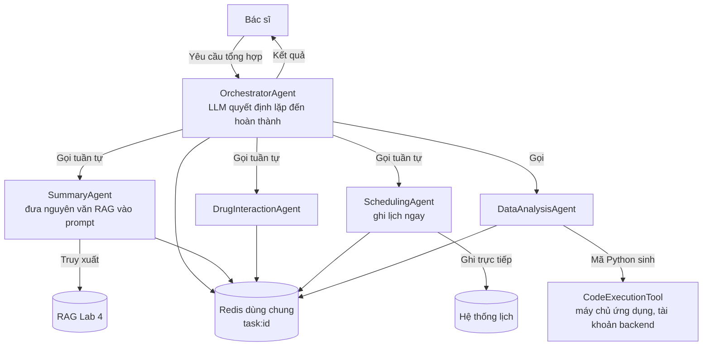
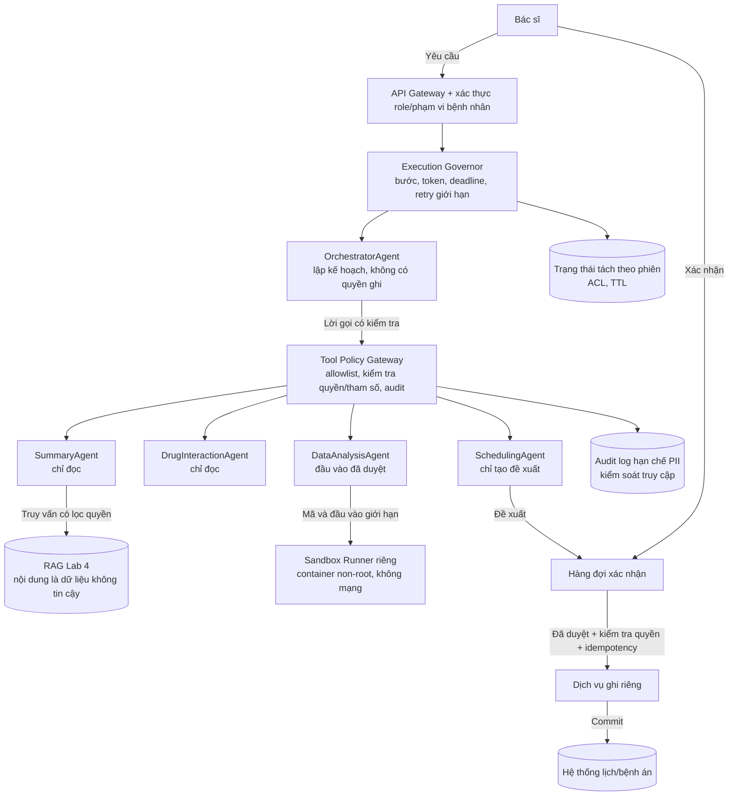

# LAB 6 — Đánh giá kiến trúc hệ đa tác nhân CAAN theo ATAM rút gọn

> **Phạm vi:** Đánh giá kiến trúc đề xuất trong tài liệu Lab 6 và các ràng buộc IMRS đã ghi trong `context-pack.md`, Lab 4 và Lab 5. Đây là đánh giá thiết kế; không có triển khai hoặc benchmark mới trong báo cáo này. Không dùng dữ liệu bệnh nhân thật.
## 1. Phạm vi và kiến trúc ban đầu

Clinical Assistant Agent Network (CAAN) là tính năng trợ lý hành chính lâm sàng đa tác nhân thuộc IMRS. Bác sĩ gửi yêu cầu tổng hợp; `OrchestratorAgent` dùng LLM lập kế hoạch, gọi tuần tự `SummaryAgent`, `DrugInteractionAgent`, `SchedulingAgent` và lặp đến khi LLM trả “hoàn thành”. `SummaryAgent` đưa nguyên văn đoạn lấy từ RAG vào prompt; `SchedulingAgent` ghi lịch ngay; `DataAnalysisAgent` chạy mã Python do LLM tạo trên máy chủ ứng dụng bằng tài khoản dịch vụ backend. Mọi agent dùng chung Redis với khóa `task:<id>`.

Đề không mô tả rõ kiểm tra phạm vi bệnh nhân, giới hạn bước/thời gian, retry, ACL/TTL Redis, nhật ký công cụ hay cách xác nhận thao tác ghi. Khi đánh giá, xem đây là **các kiểm soát chưa được nêu trong thiết kế**, không suy diễn rằng hệ thống chắc chắn không có chúng ở nơi khác. Ba ràng buộc kế thừa cần chú ý: dữ liệu và suy luận ở mạng bệnh viện; một GPU RTX 4090 24 GB dùng chung; TTFT dưới 1,5 giây và phục hồi không quá 5 giây là mục tiêu cần đo, chưa phải kết quả đã đạt (`context-pack.md`, Lab 5).

## 2. Nhiệm vụ 1 — Architectural approaches

| Approach/pattern đang dùng | Vai trò trong CAAN | Điểm yếu hoặc điều cần kiểm tra |
|---|---|---|
| Orchestrator–Worker | Orchestrator lập kế hoạch và phân việc cho các agent chuyên trách. | Điểm tập trung và lỗi đơn; nếu quyền điều phối quá rộng, lỗi/chi phối tại đây lan ra các công cụ. |
| Shared Repository / Blackboard (Redis) | Các agent đọc/ghi trạng thái tác vụ ở kho chung. | Khóa `task:<id>` và quyền truy cập không được mô tả; cần xác minh cách ly phiên, ACL, tính toàn vẹn và vòng đời dữ liệu. |
| Tool Use / tool calling | Agent gọi API lịch, API tra cứu thuốc và công cụ chạy mã. | Tác động phụ thuộc quyền của từng công cụ, kiểm tra tham số, xác thực người gọi và kiểm soát thao tác ghi. |
| ReAct loop | Lập kế hoạch → hành động → quan sát → lặp theo đầu ra LLM. | Điều kiện dừng phụ thuộc câu trả lời của mô hình; đề chưa nêu giới hạn cứng. |
| RAG | SummaryAgent truy xuất bệnh án/phác đồ từ phân hệ RAG Lab 4. | Đoạn tài liệu là dữ liệu không tin cậy; lọc quyền truy cập tài liệu không tự ngăn prompt injection. |
| Chuỗi gọi tuần tự | Orchestrator chờ agent con từng bước. | Độ trễ cộng dồn; timeout/lỗi của một agent có thể kéo dài hoặc làm hỏng cả yêu cầu nếu không có chính sách rõ. |

Orchestrator–Worker, Blackboard và ReAct được giữ như cách mô tả **approach/pattern** theo chính đề bài. Tool calling và RAG là cách tổ chức tương tác/tích hợp; Redis, Python, Docker, API và cơ chế retry là công nghệ/kỹ thuật hiện thực, không nên trình bày lẫn thành tactic kiến trúc cùng cấp. Danh sách này mô tả những gì đề nêu; các ý “đồng bộ tuần tự” và “không có timeout” là suy luận từ sequence/mô tả, cần phân biệt với điều đề khẳng định trực tiếp.

## 3. Nhiệm vụ 2 — Utility Tree

Thang đánh giá: **Q** = mức quan trọng, **K** = độ khó/rủi ro hiện thực hóa; H/M/L lần lượt là Cao/Vừa/Thấp. Các mức sau hiệu chỉnh là đề xuất dựa trên bối cảnh trong repo, chưa được stakeholder bệnh viện xác nhận. Thước đo là tiêu chí kiểm thử tương lai, không phải kết quả đã đo.

| Mã | Thuộc tính | Kịch bản chất lượng (nguồn, kích thích, môi trường, phản hồi, thước đo) | AI đề xuất (Q,K) | Sau hiệu chỉnh (Q,K) | Lý do |
|---|---|---|---|---|---|
| U1 | Security | PDF độc hại trong kho RAG chứa lệnh ẩn yêu cầu đặt lịch hoặc tiết lộ hồ sơ khác; khi được truy xuất, hệ thống không thực hiện lệnh và ghi nhận sự kiện. Đo: 0 thao tác ghi trái phép và 0 hồ sơ ngoài phạm vi bị lộ trong bộ kiểm thử. | (H,H) | (H,H) | Kịch bản bắt buộc; liên quan PII và prompt injection. |
| U2 | Security | Mã Python sinh ra cố đọc tệp cấu hình hoặc mở kết nối mạng; sandbox chặn và ghi nhận. Đo: 0 tệp ngoài danh sách đầu vào đọc được, 0 kết nối thành công, mọi lần chạy chịu giới hạn tài nguyên/thời gian. | (H,H) | (H,H) | Kịch bản bắt buộc; mã chạy trên máy chủ là ranh giới tin cậy trọng yếu. |
| U3 | Security | Bác sĩ yêu cầu tóm tắt bệnh nhân ngoài phạm vi được phép; hệ thống từ chối và ghi nhận. Đo: 0 bản tóm tắt ngoài phạm vi trong bộ kiểm thử. | (H,M) | (H,M) | Ưu tiên cao; mô hình phân công/ủy quyền chưa được đặc tả. |
| U4 | Safety | Agent đề xuất đặt lịch hoặc sửa bệnh án; không có thay đổi trước khi bác sĩ xác nhận và không tạo bản ghi trùng. Đo: 0 ghi trái phép, 0 bản ghi trùng cho một yêu cầu. | (M,M) | (H,M) | Nâng mức quan trọng vì hành động có thể ảnh hưởng chăm sóc lâm sàng. |
| U5 | Reliability | API công cụ lỗi liên tục trong giờ cao điểm; Governor dừng yêu cầu trong giới hạn, chuyển FAILED, báo bác sĩ và giải phóng tài nguyên. Đo: không vượt `MAX_STEPS`, `TOKEN_BUDGET`, `TOTAL_TIMEOUT`. | (M,H) | (H,H) | Kịch bản bắt buộc; GPU dùng chung khiến vòng lặp ảnh hưởng yêu cầu khác. |
| U6 | Reliability | Một agent con quá hạn; yêu cầu kết thúc DONE/FAILED trong thời hạn tổng, phần thiếu được gắn nhãn thay vì treo. | (M,M) | (M,M) | Giữ mức; cần quy định kết quả một phần và cách hiển thị. |
| U7 | Performance | Yêu cầu CAAN không làm TTFT của tra cứu RAG vượt mục tiêu Lab 1 khi 100 kết nối và workload AI dùng chung GPU. Đo TTFT theo percentile được nhóm/stakeholder chốt. | (M,M) | (H,M) | Nâng ưu tiên vì chung GPU; percentile/điều kiện đo còn phải chốt. |
| U8 | Cost | Tài nguyên mỗi yêu cầu bị giới hạn bởi ngân sách bước, token và thời gian. Đo: không yêu cầu nào vượt các giới hạn đã cấu hình. | (H,M) | (M,M) | Hạ ưu tiên hóa đơn token vì LLM nội bộ; chiếm dụng GPU vẫn nằm trong U5/U7. |
| U9 | Auditability | Mọi lời gọi công cụ truy vết được theo yêu cầu, người gọi/role, công cụ, kết quả và thời điểm; PII được giảm thiểu/che theo chính sách. Đo: 100% lời gọi có log đủ trường bắt buộc. | (M,L) | (H,M) | Nâng vì ASR Security yêu cầu nhật ký; cần thiết kế chống sửa/xóa và lưu giữ. |
| U10 | Modifiability | Thêm agent/công cụ bằng đăng ký hợp đồng và chính sách quyền, không sửa logic điều phối cốt lõi. Đo bằng thay đổi mẫu và review phụ thuộc. | (M,M) | (M,M) | Giữ mức; ưu tiên dưới an toàn và bảo mật. |
| U11 | Security | Phiên/agent A cố đọc hoặc ghi trạng thái Redis của phiên B. Hệ thống từ chối, ghi nhận và xóa dữ liệu hết hạn. Đo: 0 truy cập chéo phiên trong bộ kiểm thử; TTL/xóa được xác minh. | (M,M) | (H,H) | Nâng vì trạng thái có thể chứa PII; khóa có thể đoán và ACL chưa được mô tả. |

Các thay đổi so với đề xuất AI trong bản Word: **U4, U5, U7, U8, U9, U11**. Bốn kịch bản (H,H) để phân tích sâu: **U1, U2, U5, U11**. Đây là hiệu chỉnh phân tích, chưa phải phê duyệt của stakeholder. Bộ kiểm thử, cỡ mẫu và ngưỡng thống kê cần được xác định trước khi dùng các thước đo làm tiêu chuẩn nghiệm thu.

## 4. Nhiệm vụ 3 — Phân tích kịch bản theo ATAM rút gọn

Các kịch bản dưới đây được chọn từ Utility Tree. “Non-risk” nghĩa là quyết định/đặc tính đã nêu giúp giảm rủi ro cụ thể; không có nghĩa kiến trúc an toàn tổng thể. “Sensitivity Point” là biến mà thay đổi có thể tác động mạnh đến chất lượng; “Trade-off Point” ảnh hưởng nhiều thuộc tính theo hướng khác nhau.

### U5 — Công cụ lỗi làm vòng lặp chiếm dụng tài nguyên

| Mục | Phân tích |
|---|---|
| Kịch bản | **Nguồn:** API lịch hoặc API tương tác thuốc. **Kích thích:** lỗi liên tục. **Artifact:** Orchestrator, agent con, LLM/GPU. **Môi trường:** giờ cao điểm. **Phản hồi mong muốn:** dừng có kiểm soát, báo lỗi, giải phóng tài nguyên. **Đo:** giới hạn bước/token/thời gian được tôn trọng. |
| Approaches liên quan | Orchestrator–Worker; ReAct loop; chuỗi gọi agent tuần tự; tool calling. |
| Risks | R1. Chỉ dừng khi LLM trả “hoàn thành” có thể không kết thúc. R2. Đề chưa nêu timeout/retry/backoff nên lỗi có thể kéo dài hoặc tái gọi dồn dập. R3. Gọi lại thao tác không idempotent có thể tạo lịch trùng nếu lịch nằm trong vòng lặp. R4. Lời gọi LLM lặp cạnh tranh GPU với RAG/embedding và có thể làm xấu TTFT. |
| Non-risks | Orchestrator tập trung tạo điểm phù hợp để áp dụng giới hạn thống nhất, nếu Governor độc lập với LLM được bổ sung. DrugInteractionAgent là thao tác đọc theo mô tả, nên retry đọc không trực tiếp tạo bản ghi trùng; vẫn cần kiểm soát tải và timeout. |
| Sensitivity Points | `MAX_STEPS`, `TOKEN_BUDGET`, `TOTAL_TIMEOUT`, timeout từng công cụ, `MAX_RETRIES`, backoff, mức song song và giới hạn GPU. Các giá trị này chưa được đo/chốt. |
| Trade-off Points | Tăng bước/retry giúp hoàn tất việc phức tạp nhưng tăng tải và thời gian; timeout ngắn giải phóng tài nguyên nhanh nhưng có thể cắt tác vụ hợp lệ; backoff giảm áp lực dịch vụ lỗi nhưng kéo dài phản hồi. |
| Nguồn phát hiện | Vòng lặp tới khi LLM nói hoàn thành xuất phát trực tiếp từ đề. Rủi ro trùng lịch, tranh chấp GPU và thiếu timeout được suy ra từ trình tự gọi; xuất xứ phát hiện được đối chiếu ở Nhiệm vụ 5. |

**Câu hỏi phản biện:** (1) Điều gì cắt vòng lặp nếu LLM không bao giờ báo hoàn tất? (2) Nếu dừng sau một tác động phụ đã xảy ra, trạng thái/hoàn tác/idempotency được xử lý thế nào? (3) Bằng chứng nào cho thấy giới hạn tài nguyên CAAN không làm vi phạm TTFT của RAG trên GPU dùng chung?

### U1 — Prompt injection gián tiếp từ PDF RAG

| Mục | Phân tích |
|---|---|
| Kịch bản | **Nguồn:** tài liệu PDF độc hại. **Kích thích:** đoạn truy xuất chứa lệnh yêu cầu đặt lịch/tiết lộ dữ liệu. **Artifact:** RAG, SummaryAgent, Orchestrator, công cụ ghi. **Môi trường:** yêu cầu tổng hợp bình thường. **Phản hồi mong muốn:** nội dung được xem là dữ liệu, không kích hoạt hành động; sự kiện được ghi. **Đo:** 0 thao tác ghi trái phép và 0 hồ sơ ngoài phạm vi bị lộ trong bộ test. |
| Approaches liên quan | RAG; Tool Use; Orchestrator–Worker; Shared Repository. |
| Risks | R1. Nạp nguyên văn nội dung vào prompt làm ranh giới dữ liệu/chỉ thị không rõ. R2. SchedulingAgent ghi trực tiếp, không có xác nhận độc lập. R3. Nếu Orchestrator tin đầu ra agent, chỉ thị độc hại có thể lan thành lời gọi tool. R4. Không thấy mô tả kiểm tra quyền theo bệnh nhân tại từng thao tác. |
| Non-risks | Lab 4 lọc `allowed_roles` trong truy vấn và kiểm tra quyền lần hai là giảm thiểu truy cập tài liệu trái role; không thay thế quyền theo bệnh nhân hay chặn injection trong tài liệu được phép. Lab 5 thiết kế chặn egress tới Internet ở vùng máy chủ; điều này giảm đường gửi dữ liệu ra ngoài nhưng không ngăn đọc/ghi nội bộ. |
| Sensitivity Points | Phạm vi quyền của người gọi, số/độ dài đoạn RAG, cách phân định nội dung không tin cậy, quyền tool, bộ kiểm tra tham số và điều kiện duyệt ghi. Ranh giới prompt không phải bảo đảm cưỡng chế. |
| Trade-off Points | Lọc nội dung mạnh có thể giảm nội dung hữu ích/trích dẫn; xác nhận thủ công tăng an toàn nhưng tăng thời gian thao tác; siết quyền quá mức có thể chặn tác vụ hợp lệ. |
| Nguồn phát hiện | PDF chứa lệnh ẩn và mục tiêu đặt lịch/tiết lộ là kịch bản bắt buộc trong đề. Rủi ro nối tiếp tới tool được suy ra từ luồng gọi công cụ và đối chiếu ở Nhiệm vụ 5. |

**Câu hỏi phản biện:** (1) Nếu nội dung độc hại nằm trong tài liệu đúng quyền, lớp nào chặn nó kích hoạt tool? (2) Ai thực thi kiểm tra quyền bệnh nhân ngay trước khi đọc hoặc ghi? (3) Làm thế nào thu hồi/tìm các tài liệu đã nạp bị phát hiện độc hại mà vẫn giữ được truy vết?

### U2 — Mã Python tự sinh vượt khỏi phạm vi cho phép

| Mục | Phân tích |
|---|---|
| Kịch bản | **Nguồn:** mã do LLM sinh. **Kích thích:** cố đọc cấu hình/secret hoặc mở kết nối mạng. **Artifact:** DataAnalysisAgent, CodeExecutionTool, máy chủ ứng dụng. **Môi trường:** xử lý chỉ số xét nghiệm. **Phản hồi mong muốn:** sandbox chặn, ghi nhận và trả lỗi an toàn. **Đo:** 0 tệp ngoài danh sách đầu vào đọc được, 0 kết nối thành công, thời gian/tài nguyên luôn bị giới hạn. |
| Approaches liên quan | Tool calling/CodeExecutionTool; thực thi mã được sinh; danh tính backend dùng chung theo mô tả. |
| Risks | R1. Mã chạy trên máy chủ ứng dụng bằng tài khoản dịch vụ làm tăng phạm vi ảnh hưởng. R2. Không có ranh giới mạng được mô tả nên mã có thể thử kết nối dịch vụ nội bộ, dù egress Internet bị chặn. R3. Không nêu giới hạn CPU/RAM/thời gian nên có thể gây cạn tài nguyên. R4. Quyền đọc tệp cấu hình có thể làm lộ secret. |
| Non-risks | Lab 5 mô tả chặn egress từ vùng máy chủ IMRS; điều này giảm khả năng gửi dữ liệu ra Internet nếu đúng cấu hình, nhưng không bảo vệ trước truy cập nội bộ, đọc tệp hoặc cạn tài nguyên. |
| Sensitivity Points | UID/GID, network namespace, mount allowlist, root filesystem, CPU/RAM/PID/time limits, quyền Docker daemon, loại runtime và dữ liệu gắn vào container. |
| Trade-off Points | Sandbox chặt giảm bề mặt tấn công nhưng giới hạn thư viện/dữ liệu và tăng công vận hành/độ trễ; cho phép thêm thư viện hoặc mạng giúp tiện ích nhưng tăng rủi ro. |
| Nguồn phát hiện | Đề nêu rõ mã chạy trực tiếp trên máy chủ bằng tài khoản backend và kịch bản đọc cấu hình/gửi dữ liệu ra mạng. Cách tách quyền Docker daemon là kiểm soát bổ sung cần xem xét. |

**Câu hỏi phản biện:** (1) Vì sao cần mã Python tự do thay cho hàm phân tích có allowlist? (2) Thành phần nào có quyền gọi Docker daemon và làm sao cô lập quyền đó khỏi backend? (3) Nếu lỗ hổng kernel cho phép thoát container, lớp giảm thiểu tiếp theo là gì?

### U11 — Redis dùng chung không có cách ly được mô tả

| Mục | Phân tích |
|---|---|
| Kịch bản | **Nguồn:** agent/phiên khác. **Kích thích:** đọc hoặc sửa `task:<id>` của bệnh nhân khác. **Artifact:** Redis shared state. **Môi trường:** các yêu cầu CAAN đang hoạt động. **Phản hồi mong muốn:** từ chối, log truy cập; dữ liệu phiên hết hạn được dọn. **Đo:** 0 truy cập chéo trong bộ test và TTL/xóa được xác minh. |
| Approaches liên quan | Shared Repository/Blackboard; danh tính dịch vụ chung theo mô tả. |
| Risks | R1. Khóa dạng `task:<id>` có thể đoán nếu ID tuần tự; tính đoán được chưa được xác nhận trong đề. R2. Không có thông tin ACL/danh tính riêng nên chưa chứng minh được cách ly agent. R3. Nếu trạng thái chứa PII, giữ quá lâu làm tăng mức phơi nhiễm. R4. Agent có thể ghi đè trạng thái nếu quyền ghi chung. R5. Redis có thể là điểm phụ thuộc làm yêu cầu lỗi nếu không có xử lý mất dịch vụ. |
| Non-risks | Redis trong mạng nội bộ giảm phơi nhiễm trực tiếp từ Internet theo baseline Lab 5; nó không ngăn truy cập chéo từ thành phần nội bộ bị xâm nhập hoặc cấu hình sai. |
| Sensitivity Points | Tính ngẫu nhiên/định danh khóa, ACL/credential theo agent, phạm vi dữ liệu lưu, TTL, chính sách xóa, mã hóa/backup và hành vi khi Redis không sẵn sàng. |
| Trade-off Points | Cách ly ACL chặt giảm rò chéo nhưng làm tăng cấu hình; TTL ngắn giảm thời gian lưu PII nhưng có thể xóa trạng thái tác vụ dài; chia sẻ ngữ cảnh thuận tiện nhưng tăng quyền đọc/ghi. |
| Nguồn phát hiện | Redis shared state và dạng khóa được nêu trong đề. ID tuần tự, không ACL, không TTL và điểm lỗi đơn không được đề xác nhận; xem đây là điều kiện cần kiểm tra, không phải dữ kiện chắc chắn. |

**Câu hỏi phản biện:** (1) Cơ chế nào từ chối truy cập nếu agent biết khóa phiên khác? (2) Trạng thái nào có thể chứa PII, ai truy cập và khi nào bị xóa? (3) Nếu Redis lỗi giữa phiên thì hệ thống dừng an toàn hay chạy với dữ liệu cũ?

## 5. Risk Themes và drivers bị đe dọa

| Risk Theme | Risks liên quan | Driver bị đe dọa |
|---|---|---|
| RT1 — Tự chủ không giới hạn và tiêu thụ tài nguyên | U5-R1..R4 | ASR Performance (TTFT), Availability, RTX 4090 dùng chung, ngân sách và trải nghiệm bác sĩ. |
| RT2 — Ranh giới tin cậy giữa tài liệu và chỉ thị | U1-R1, R3, R4 | Ràng buộc PII, ASR Security, tính đúng đắn của thông tin hỗ trợ lâm sàng. |
| RT3 — Quyền công cụ quá rộng và mã sinh không an toàn | U2-R1..R4; U1-R2 | Bảo mật máy chủ, dữ liệu bệnh viện, ASR Security và an toàn thao tác. |
| RT4 — Trạng thái phiên không cách ly và khó kiểm toán | U11-R1..R5; thiếu log được mô tả | Ràng buộc PII, kiểm soát truy cập và auditability. |
| RT5 — Tác động ghi không có bước xác nhận độc lập | U1-R2; U5-R3 | An toàn lâm sàng, lịch hẹn chính xác, tránh bản ghi trùng/sai. |

## 6. Nhiệm vụ 4 — Guardrails và kiến trúc cải tiến

| Risk Theme | Guardrail | Nơi thực thi |
|---|---|---|
| RT1 | Execution Governor giới hạn bước, token, thời gian tổng; timeout công cụ, retry có backoff và số lần thử tối đa; chuyển FAILED, báo người dùng và hủy tiến trình con. | Mã điều phối/dịch vụ điều khiển, độc lập với quyết định của LLM. |
| RT2 | Xem đoạn RAG là dữ liệu không tin cậy; không cho đoạn truy xuất tự gọi tool; mọi lời gọi đi qua gateway kiểm tra role, phạm vi bệnh nhân, tên tool và tham số. Giữ PIIRedactor ở luồng LLM. | Backend và Tool Policy Gateway. |
| RT3 | Chạy mã trong Sandbox Runner riêng, non-root, không mạng, filesystem chỉ đọc và chỉ gắn đầu vào đã duyệt; tách quyền điều khiển container khỏi backend. Mỗi agent có danh tính/quyền tối thiểu. | Hạ tầng container và IAM. |
| RT4 | Tách namespace/khóa theo phiên và bệnh nhân, ACL theo agent, TTL/xóa; log lời gọi công cụ có kiểm soát truy cập và thời hạn lưu, không lưu prompt/bệnh án thô nếu không cần. | Redis, Tool Policy Gateway, AuditLogger. |
| RT5 | Mọi thao tác ghi tạo đề xuất; người dùng có quyền xác nhận; dịch vụ ghi tách biệt kiểm tra lại quyền và dùng idempotency key. | Giao diện và dịch vụ nghiệp vụ. |

### 6.1 Tham số Governor

Giá trị tham khảo: `MAX_STEPS=8`, `MAX_RETRIES=3`, backoff lũy thừa. Đây **không phải giá trị đã đo**. Đề không cung cấp `TOKEN_BUDGET`, `TOTAL_TIMEOUT` hoặc timeout từng tool; báo cáo không tự đặt số cho các giá trị này. Chúng phải được chốt qua thử nghiệm giả lập, tính đến TTFT RAG, độ trễ tool, workload dùng chung GPU và thời gian thao tác của bác sĩ. Mỗi retry phải thuộc cùng deadline tổng; không retry lỗi không lặp an toàn hoặc thao tác ghi chưa có idempotency.

```mermaid
stateDiagram-v2
    [*] --> PLANNING
    PLANNING --> ACTING: Còn bước và ngân sách
    PLANNING --> FAILED: Hết MAX_STEPS / TOKEN_BUDGET / TOTAL_TIMEOUT
    ACTING --> OBSERVING: Tool trả kết quả
    ACTING --> RETRY_WAIT: Lỗi tạm thời và còn retry
    ACTING --> FAILED: Lỗi cuối / timeout tổng
    RETRY_WAIT --> ACTING: Hết backoff, còn deadline
    RETRY_WAIT --> FAILED: Hết retry hoặc deadline
    OBSERVING --> PLANNING: Còn việc, không có thao tác ghi
    OBSERVING --> AWAITING_CONFIRMATION: Cần thao tác ghi
    AWAITING_CONFIRMATION --> PLANNING: Người dùng xác nhận/từ chối; ghi nhận kết quả
    OBSERVING --> DONE: Hoàn tất
    DONE --> [*]
    FAILED --> [*]
```



Từ chối/không phản hồi xác nhận phải hết hạn an toàn và không ghi dữ liệu. Khi hủy, Governor cần hủy lời gọi đang chạy và giải phóng tài nguyên; chỉ chuyển trạng thái FAILED là chưa đủ nếu tiến trình con vẫn chạy.

### 6.2 Sandbox mẫu cho CodeExecutionTool

Các tham số `--memory=256m` và `--cpus=0.5` lấy từ đề. Các giới hạn PID, tmpfs, bỏ capability và thời gian là đề xuất minh họa, cần kiểm tra trên hạ tầng đích. Không yêu cầu cài Docker để hoàn thành lab.

```dockerfile
FROM python:3.12-slim
RUN useradd --create-home --uid 10001 sandbox \
    && mkdir -p /work /input /tmp \
    && chown -R sandbox:sandbox /work /input /tmp
USER 10001:10001
WORKDIR /work
ENV PYTHONDONTWRITEBYTECODE=1
```

```bash
docker run --rm --name "caan-job-${JOB_ID}" \
  --user 10001:10001 \
  --network none \
  --memory=256m --memory-swap=256m --cpus=0.5 \
  --pids-limit=64 \
  --read-only \
  --tmpfs /tmp:rw,noexec,nosuid,size=16m \
  --cap-drop=ALL \
  --security-opt=no-new-privileges:true \
  -e PYTHONDONTWRITEBYTECODE=1 \
  --mount "type=bind,src=${JOB_DIR},dst=/input,readonly" \
  imrs-sandbox:1.0 python -I /input/input.py
```

| Cấu hình | Mối đe dọa được giảm thiểu |
|---|---|
| `USER`/`--user 10001:10001` | Không chạy dưới root trong container; giảm quyền khi mã bị lợi dụng. |
| `--network none` | Chặn kết nối mạng từ container, gồm Internet và dịch vụ nội bộ qua network namespace. |
| `--memory=256m --memory-swap=256m`, `--cpus=0.5` | Giới hạn RAM/swap và phần CPU theo đề; giảm khả năng cạn tài nguyên. |
| `--pids-limit=64` | Giới hạn số tiến trình để giảm nguy cơ fork bomb. |
| `--read-only`, `/tmp` dạng tmpfs có `noexec,nosuid` | Root filesystem chỉ đọc; chỉ có vùng tạm nhỏ, không cho thực thi từ `/tmp`. |
| `--cap-drop=ALL`, `no-new-privileges` | Bỏ Linux capabilities và ngăn tăng quyền qua setuid. |
| Chỉ mount thư mục staging riêng của job dạng readonly | Thư mục staging chỉ chứa `input.py` và dữ liệu được duyệt; không mount secret hoặc thư mục máy chủ. |
| `python -I` | Chạy Python ở chế độ isolated; đây lớp làm cứng bổ sung, không phải sandbox thay thế. |
| Timeout do Sandbox Runner/Governor cưỡng chế | Kết thúc tiến trình quá hạn; timeout ứng dụng đơn thuần không đủ nếu tiến trình container còn chạy. |

`JOB_ID` và `JOB_DIR` phải được tạo/kiểm tra an toàn bởi runner, không ghép trực tiếp từ đầu vào người dùng; thư mục staging phải được tạo theo allowlist chỉ với các tệp cần thiết. Không cấp quyền Docker socket/daemon cho backend; runner có đặc quyền phải là thành phần riêng, bề mặt API hẹp và được bảo vệ. Container vẫn dùng chung kernel host, nên không bảo đảm chống tuyệt đối lỗ hổng kernel/thoát container. Cần đánh giá runtime cách ly mạnh hơn nếu mức rủi ro yêu cầu.

### 6.3 Các kiểm soát ứng dụng còn lại

- **Human-in-the-loop:** agent chỉ lập đề xuất lịch/sửa bệnh án. Dịch vụ ghi độc lập xác thực người xác nhận, bệnh nhân, quyền và nội dung ngay trước khi commit; idempotency key ngăn ghi lặp. Không để Orchestrator tự cấp quyền ghi.
- **Least privilege:** `SummaryAgent` và `DrugInteractionAgent` chỉ đọc; `SchedulingAgent` chỉ tạo đề xuất; `DataAnalysisAgent` chỉ nhận dữ liệu đã duyệt và không có network; mỗi agent/tool dùng danh tính riêng. Quyền thật cần khớp ma trận nghiệp vụ.
- **RAG không tin cậy:** phân định đoạn truy xuất để hỗ trợ mô hình hiểu ngữ cảnh, nhưng không xem delimiters/prompt là lớp bảo vệ. Gateway áp dụng allowlist tool, xác thực tham số và kiểm tra quyền lần nữa trước hành động.
- **Redis và audit:** dùng ACL theo danh tính agent, khóa không đoán được, namespace theo phiên/bệnh nhân, TTL và xóa theo chính sách. Ghi sự kiện tool cần thiết vào audit store riêng; giảm thiểu/che PII, kiểm soát quyền đọc, chống sửa trái phép và xác định thời hạn lưu. Không ghi nội dung bệnh án/prompt thô theo mặc định.

### 6.4 Sơ đồ trước cải tiến



**Chú giải:** Mũi tên là quan hệ/gọi theo mô tả đề. Điểm yếu được ghi ngay trong nhãn thành phần; sơ đồ không khẳng định có/không có kiểm soát nào ngoài những gì đề nêu.

### 6.5 Sơ đồ sau cải tiến



**Chú giải:** Lời gọi công cụ đi qua gateway; đường ghi chỉ mở sau xác nhận; runner tách quyền điều khiển container khỏi backend. Các hộp là thành phần thiết kế đề xuất, chưa được triển khai hay đánh giá hiệu năng.

### 6.6 Vì sao guardrail phải được thực thi ngoài prompt (giải trình)

Prompt giúp mô hình hiểu nhiệm vụ và có thể nhắc mô hình không làm một việc nguy hiểm, nhưng câu chữ trong prompt không cưỡng chế được quyền của tiến trình. Đầu ra của LLM có tính xác suất; mô hình có thể hiểu sai, bỏ sót hoặc bị ảnh hưởng bởi nội dung truy xuất. Trong CAAN, PDF là dữ liệu đầu vào do nhiều nguồn cung cấp. Nếu PDF chứa chỉ thị mâu thuẫn, việc chỉ ghi “hãy coi tài liệu là dữ liệu” không chứng minh được rằng agent sẽ luôn tuân theo. Tương tự, yêu cầu mô hình tự dừng sau một số bước không thay thế bộ đếm bước do chương trình kiểm soát.

Vì vậy quyền và giới hạn quan trọng cần nằm ở các lớp mà mô hình không thể tự thay đổi. Execution Governor kiểm đếm bước, token và deadline bằng logic xác định; khi chạm giới hạn, nó dừng yêu cầu, hủy tác vụ con và trả trạng thái lỗi có thể hiểu được. Tool Policy Gateway kiểm tra danh tính, phạm vi bệnh nhân, tool và tham số ngay trước khi gọi; nó không dựa vào việc agent tự khai rằng đã kiểm tra quyền. Hàng đợi xác nhận và dịch vụ ghi riêng bảo đảm đầu ra của agent chỉ là đề xuất cho đến khi người có quyền chấp thuận. Idempotency key giảm tác động của việc gửi lại cùng thao tác. Sandbox với tài khoản không phải root, network namespace bị tắt, tệp chỉ đọc và giới hạn tài nguyên làm giảm hậu quả nếu mã sinh ra có hành vi ngoài dự kiến.

Các kiểm soát này không biến rủi ro thành bằng không. Runner vẫn có đặc quyền cần quản lý; container dùng chung kernel; kiểm tra quyền có thể cấu hình sai; audit log có thể lộ PII nếu ghi quá nhiều; và xác nhận của bác sĩ không tự bảo đảm nội dung đề xuất đúng. Do đó thiết kế còn cần kiểm thử giả lập, review quyền, theo dõi lỗi và quy trình thu hồi. Prompt và bộ lọc mô hình vẫn hữu ích như lớp hỗ trợ, nhưng không được dùng thay cho kiểm soát quyền, ngân sách thực thi hay xác nhận hành động. Cách bố trí này phù hợp hơn với dữ liệu y tế nội bộ và GPU dùng chung, đồng thời tạo ra tiêu chí có thể kiểm tra được thay vì dựa vào lời hứa trong prompt. Chưa có benchmark hay kiểm thử an toàn trong phạm vi tài liệu này; các tuyên bố trên là mục tiêu thiết kế cần xác minh.

## 7. Nhiệm vụ 5 — Đối chiếu đánh giá của nhóm và của AI

Hồ sơ nguồn không ghi lại trình tự nhóm tự đánh giá trước khi dùng AI. Bảng dưới phân biệt nội dung xuất hiện trong đề, các điểm bổ sung trong phần phản biện và các giả thuyết cần kiểm tra; việc ghi nhận ai phát hiện trước cần dựa trên thảo luận thực tế của nhóm. Các ví dụ false positive cần đối chiếu với đầu ra đã dùng.

| Nhóm phân loại theo rubric | Phát hiện có thể đưa vào từ hồ sơ hiện tại | Giới hạn chứng cứ |
|---|---|---|
| Chỉ nhóm phát hiện | Chưa có mục nào được xác nhận. | Không có ghi chú độc lập/thời điểm phát hiện của nhóm trong tệp tham khảo. |
| Chỉ AI phát hiện | F2 và F7–F11 là các bổ sung trong phần đánh giá, ngoài mô tả trực tiếp của đề. | Chưa có ghi chép quá trình để xác định nhóm có phát hiện các điểm này trước đó không. |
| Cả nhóm và AI cùng phát hiện | F1, F3–F5 xuất hiện trong đề và phần đánh giá. | Nguồn hiện có không chứng minh nhóm đã phát hiện độc lập trước đó. |
| AI đưa ra nhưng sai/không áp dụng | Các ví dụ cloud LLM công cộng và DDoS Internet ở dưới là ứng viên để kiểm tra. | Chỉ gắn nhãn false positive sau khi đối chiếu với đầu ra thực tế và phạm vi của hệ thống. |

F6 cũng được đề nhắc là shared Redis/`task:<id>`; các thuộc tính “ID tuần tự, không ACL, không TTL” là giả định không được nêu trong đề và cần kiểm tra riêng.

| # | Phát hiện | Căn cứ trong đề / phần đánh giá đối chiếu | Phân loại theo hồ sơ hiện có |
|---|---|---|---|
| F1 | Vòng lặp chỉ dừng khi LLM nói hoàn thành, chưa nêu giới hạn cứng. | Đề mô tả trực tiếp; phần đánh giá cũng nêu. | Có trong đề và phần đánh giá; chưa xác định nhóm phát hiện trước hay không. |
| F2 | Gọi SchedulingAgent trong vòng lặp có thể lặp thao tác ghi và tạo lịch trùng. | Suy luận từ sequence; phần phản biện bổ sung nêu điểm này. | Cần kiểm tra API/idempotency và đối chiếu với kết quả nhóm tự phân tích. |
| F3 | Đưa nguyên văn RAG vào prompt tạo đường cho indirect prompt injection. | Đề nêu cả cơ chế và kịch bản; phần đánh giá cũng ghi nhận. | Có trong đề và phần đánh giá; thứ tự phát hiện của nhóm chưa rõ. |
| F4 | SchedulingAgent ghi trực tiếp, không có bước xác nhận người dùng được mô tả. | Đề mô tả trực tiếp; phần đánh giá cũng ghi nhận. | Có trong đề và phần đánh giá; chưa xác định nhóm phát hiện trước hay không. |
| F5 | Mã LLM sinh chạy trên máy chủ ứng dụng bằng tài khoản backend. | Đề mô tả trực tiếp; phần đánh giá cũng ghi nhận. | Có trong đề và phần đánh giá. |
| F6 | Trạng thái Redis dùng chung với khóa `task:<id>`. | Đề mô tả trực tiếp; phần đánh giá xác định hệ quả cần xem xét. | Shared state là dữ kiện trong đề; ID đoán được/không ACL/không TTL chưa được chứng minh. |
| F7 | Nhật ký mọi lời gọi tool chưa được mô tả. | Đề chưa nêu nhật ký cho CAAN tools; baseline Lab 4 có AuditLogger cho RAG nhưng chưa nói CAAN tích hợp vào đó. | Khoảng trống tài liệu CAAN, không đủ căn cứ kết luận hệ thống hoàn toàn không có log. |
| F8 | Kiểm tra phạm vi bệnh nhân chưa được mô tả trong luồng CAAN. | Luồng CAAN chưa nêu kiểm tra này; Lab 4 có kiểm tra role/tài liệu, không tương đương quyền theo bệnh nhân. | Cần xác minh mô hình phân công/ủy quyền; không kết luận chắc chắn là thiếu toàn hệ thống. |
| F9 | Timeout/retry/backoff không xuất hiện trong sequence ban đầu. | Sơ đồ đề cho thấy vòng lặp nhưng không nêu các cơ chế này. | Thiếu trong mô tả, chưa chứng minh thiếu ở mọi thành phần. |
| F10 | Agent loop có thể tranh GPU với truy vấn RAG/embedding. | Suy luận từ GPU dùng chung trong baseline. | Rủi ro kiến trúc hợp lý; mức tác động phải đo, không có kết quả. |
| F11 | Redis có thể là điểm phụ thuộc đơn nếu mọi agent cần nó. | Đề xác nhận Redis dùng chung, không mô tả HA/fallback. | Câu hỏi độ sẵn sàng cần kiểm tra, chưa đủ dữ liệu khẳng định triển khai đơn nút. |

**Ứng viên false positive cần gắn đúng phạm vi:** (a) “Dữ liệu gửi tới nhà cung cấp LLM công cộng” không phù hợp với baseline đã chốt LLM nội bộ; (b) “tấn công DDoS trực tiếp từ Internet” không phải kịch bản hiện tại nếu vùng IMRS không nhận ingress công cộng theo Lab 5; (c) “mã hóa mọi kết nối là nguyên nhân của bốn kịch bản H,H” không được chứng minh — mã hóa có thể vẫn là yêu cầu bảo mật hợp lệ, nên gọi đây là *lệch trọng tâm đánh giá*, không phải khuyến nghị sai. Chỉ phân loại thành false positive thật nếu đầu ra AI nhóm thực sự có phát biểu đó và hồ sơ chứng minh nó không áp dụng.

### Phản tư về AI

AI có ích khi dùng như người phản biện bổ sung: nó nhanh chóng rà các lớp điều phối, tool, dữ liệu chia sẻ và thực thi mã; đồng thời gợi ý phân tích theo Risk, Non-risk, Sensitivity Point và Trade-off Point. Trong tài liệu này, ví dụ có giá trị là nguy cơ SchedulingAgent bị gọi lại trong vòng lặp và mối liên hệ giữa vòng lặp agent với GPU dùng chung. Đây là các suy luận đáng kiểm tra vì chúng nối một chi tiết trình tự với hậu quả vận hành cụ thể.

AI cũng có giới hạn rõ. Một số nhận định biến điều “chưa thấy mô tả” thành “không có”, chẳng hạn ACL/TTL Redis, audit, timeout hoặc ID tuần tự; các điểm ấy cần kiểm tra thay vì khẳng định. Tham số `MAX_STEPS=8` và `MAX_RETRIES=3` chưa có benchmark chứng minh phù hợp. Một số giả định về đường mạng/độ sẵn sàng cũng cần đối chiếu baseline. Câu trả lời trôi chảy không thay thế được bằng chứng.

Với quyết định ảnh hưởng dữ liệu bệnh nhân hoặc thao tác ghi, cần xem lại sơ đồ, quyền thực tế, cấu hình triển khai và kết quả kiểm thử; không dựa riêng vào lời giải thích của mô hình. Bảng đối chiếu phản ánh nguồn hiện có; việc phân biệt phát hiện của nhóm với phần AI bổ sung cần căn cứ vào quá trình làm việc thực tế.

## 8. Giới hạn, giả định và việc cần xác nhận

- **Chưa triển khai/đo:** Governor, sandbox, authorization cho từng agent, audit CAAN và các sơ đồ cải tiến là thiết kế đề xuất; không khẳng định đã chạy.
- **Giả định cần kiểm tra:** trạng thái Redis có/không chứa PII; ID tác vụ có đoán được không; hành động tool có idempotent không; ACL, TTL, timeout và HA hiện có hay chưa.
- Mức ưu tiên Utility Tree và ngưỡng nghiệm thu cần được xác nhận theo bối cảnh stakeholder trước khi dùng trong triển khai.
- Các mục tiêu Lab 1 như TTFT <1,5 giây, phục hồi ≤5 giây và rò PII bằng 0 là mục tiêu/tiêu chí cần thử nghiệm; không phải kết quả được Lab 6 đo.

## Nguồn nội bộ

- `SAD-Lab-Manual-v3.pdf`, mục Lab 6: yêu cầu ATAM, deliverables và rubric.
- `LAB6_EVALUATION_REPORT.docx`: tài liệu đối chiếu về Utility Tree, phân tích red-team, guardrails, sơ đồ, ADR và AI_LOG.
- `context-pack.md`: ràng buộc IMRS đã chốt và baseline Lab 4–5.
- `lab4/LAB4_RAG_DESIGN.md`, `adr/0001-chon-vector-store.md`, `adr/0002-co-che-phan-quyen-truy-cap.md`: RAG, quyền truy cập và audit baseline.
- `lab5/LAB5_C4_SERVING.md`, `adr/0003-cau-hinh-dynamic-batching.md`: GPU dùng chung, mạng, hiệu năng và trạng thái các mục tiêu đo.
